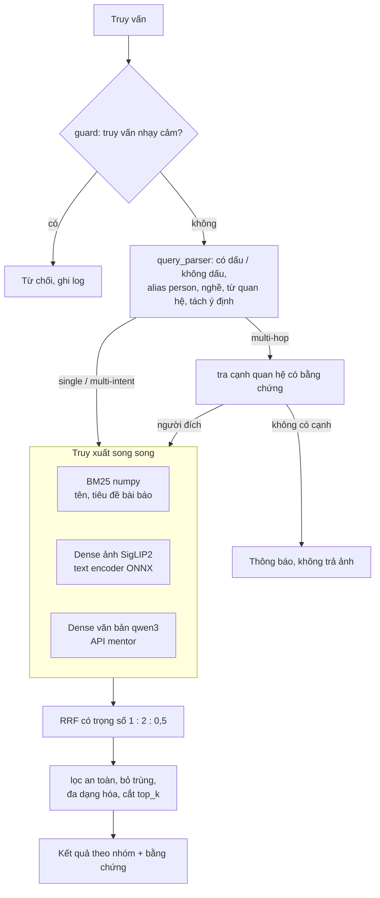
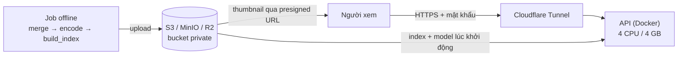

# Image Data Processing & Retrieval: ảnh người nổi tiếng Việt Nam

Capstone cá nhân (Dương Văn Kiên). Hệ thống tìm ảnh người nổi tiếng Việt Nam bằng câu tiếng Việt tự nhiên, có dấu hoặc không dấu, trên **90.056 ảnh**. Kết quả trả theo nhóm, kèm bằng chứng cho mỗi quan hệ. Trọng tâm là **Phần B: truy xuất ảnh** ([part_b/](part_b/README.md)). Phần A (kiểm duyệt ảnh) là future work ([part_a/](part_a/README.md)).

Số liệu gắn nhãn **[Đã đo]** (đo thật, ghi điều kiện) hoặc **[Ước tính]**. Máy đo: Intel Core Ultra 7 155H, 32 GB RAM, Windows 11, không GPU.

**Mục lục:** [Kết quả chính](#kết-quả-chính) · [Dữ liệu](#dữ-liệu) · [Kiến trúc](#kiến-trúc) · [API](#api) · [Đánh giá](#đánh-giá) · [Hiệu năng](#hiệu-năng) · [Triển khai](#triển-khai) · [CI/CD](#cicd) · [Chạy nhanh](#chạy-nhanh-với-dữ-liệu-giả) · [Hạn chế](#hạn-chế-chính) · [Tài liệu](#tài-liệu)

## Kết quả chính

| Hạng mục | Kết quả |
|---|---|
| Dữ liệu | 92.140 dòng CSV đã duyệt → **90.056 ảnh**; 8.029 entity gộp thành **5.653 person** [Đã đo] |
| Chất lượng (split test, 79 truy vấn, chạy một lần) | hành vi đúng 77/79, P@10 0,87, nDCG@10 0,92, MRR 0,96; multi-hop bịa 1/23 [Đã đo] |
| Latency HTTP (Docker 4 CPU / 4 GB) | p95 332 ms ở 1 VU, 1,6 s ở 16 VU; **p95 < 3 s ở mọi mức tải**, 0% lỗi [Đã đo] |
| Thông lượng | 20 QPS (mặc định), 31 QPS khi tắt kênh văn bản của mentor [Đã đo] |
| Triển khai | Docker Compose (API + MinIO); bản public trên Cloudflare R2 + Cloudflare Tunnel, có mật khẩu |
| CI | GitHub Actions: ruff, 328 test, build image Docker |

Ba loại truy vấn:

| Loại | Ví dụ | Hệ thống làm gì |
|---|---|---|
| Single-intent | "Đen Vâu", "Đặng Văn Lâm bắt bóng", "hoa hậu đội vương miện" | Nhận người hoặc chủ đề, xếp ảnh theo phần mô tả |
| Multi-intent | "Trấn Thành và Hari Won" | Mỗi vế một nhóm cân bằng, thêm nhóm ảnh có cả hai người |
| Multi-hop | "vợ của Trấn Thành", "con trai Phạm Nhật Vượng" | Đi theo cạnh quan hệ **có bằng chứng** (tiêu đề + link bài báo) rồi trả ảnh người đích. Không có bằng chứng thì báo không có và **không trả ảnh** |

Mỗi tình huống người dùng có một mã (L1 gõ không dấu, E2 trùng tên, M1 "A và B", H3 quan hệ không có bằng chứng...) trong [capstone/SCENARIOS.md](capstone/SCENARIOS.md); test case và code tham chiếu các mã này.

## Dữ liệu

Dữ liệu gốc là 3 file CSV ảnh người nổi tiếng mà cả team đã duyệt tay. Dữ liệu không có trong repo vì là ảnh người thật.

| | Số lượng [Đã đo] |
|---|---|
| Dòng CSV | 92.140, tất cả `approved`; 8.045 entity |
| Dòng thiếu sha256 | 7.979: cứu được 6.766 (lấy từ ảnh cùng URL hoặc tải lại ảnh), bỏ 1.213 |
| **Ảnh trong index** | **90.056**, mỗi sha256 một bản ghi (ảnh trùng giữa các entity chỉ hiện một lần) |
| Ảnh có tiêu đề bài báo | 79.184; caption do VLM sinh: **không có** |
| Ảnh có vector SigLIP2 / thumbnail | 89.305 (99,2%) |

Pipeline offline: tải ảnh → hợp nhất CSV (39 s) → mã hóa ảnh (~1,7 h, CPU) → dựng index (29 s) → mã hóa văn bản (23 phút, qua API mentor) → thumbnail → đẩy lên S3/R2 [Đã đo]. Kết quả là index có phiên bản `index/v{ver}/` gồm `meta.sqlite` (metadata + đồ thị tri thức), `lexical.npz` (BM25), `dense.npz` và `text_dense.npz` (vector), `manifest.json`.

- **Gộp entity thành person** (`data/entity_merge.py`): một người thường có nhiều entity ("Đen Vâu", "Đen (rapper)", "Nguyễn Đức Cường (Đen Vâu)"). Hệ thống gộp theo tên **giữ dấu** và nhóm nghề, để không gộp "Sơn Tùng" nhà văn với "Sơn Tùng M-TP".
- **Đồ thị tri thức** (`kg/article_relations.py`): cạnh quan hệ trích từ tiêu đề bài báo, luật ưu tiên độ chính xác, mỗi cạnh lưu bằng chứng. Lần đầu có 273 cạnh, phần lớn sai; sau 4 vòng sửa còn 28 cạnh. Kiểm tay 27 cạnh: 24 đúng, 1 sai đã biết [Đã đo].

## Kiến trúc

Phân tích truy vấn bằng quy tắc, liên kết person, ba kênh truy xuất chạy song song, gộp bằng RRF, rồi đi trên đồ thị tri thức cho multi-hop. Không dùng tác tử LLM vì chậm và dễ bịa quan hệ.



| Thành phần | Công nghệ |
|---|---|
| Chuẩn hóa tiếng Việt | Luôn khớp cả dạng có dấu và không dấu (`đ` → `d`), ưu tiên dạng có dấu |
| Phân tích truy vấn | Quy tắc + từ điển alias; khớp mờ (rapidfuzz) cho tên sai chính tả |
| Từ khóa | BM25 tự viết bằng numpy, tính sẵn dạng ma trận thưa |
| Dense ảnh | SigLIP2 ViT-B/32. Ảnh mã hóa offline bằng torch; truy vấn mã hóa bằng ONNX Runtime, nên image API không có torch |
| Dense văn bản | qwen3-embedding-4b qua API mentor, timeout 1 s; lỗi hoặc quá giới hạn thì tự bỏ kênh |
| API, web | FastAPI; web HTML + TypeScript thuần |
| Lưu trữ | SQLite + ma trận `.npz`; index có phiên bản trên S3 / MinIO / R2 |

Cách xử lý các trường hợp chính:
- **Có tên người**: ảnh khớp phần mô tả xếp trước, sau đó là mọi ảnh còn lại của người đó. Kênh dense nhận phần mô tả đã bỏ tên người, vì model ảnh không nhận ra mặt người nổi tiếng Việt Nam; danh tính đến từ bộ lọc person.
- **Không có tên người** ("doanh nhân phát biểu"): giới hạn theo nghề; mỗi người tối đa 3 ảnh ở đầu danh sách để kết quả đa dạng.
- **Trùng tên** ("Quang Hải"): mỗi người một nhóm, nhãn kèm nghề, gợi ý thêm nghề để chọn đúng người.
- **Tên không có trong dữ liệu**: chỉ thông báo, không trả ảnh người có tên gần giống.
- **Multi-hop có người gốc trùng tên**: hỏi lại, không chọn bừa.

Quyết định thiết kế chính:

| Quyết định | Phương án bị loại | Số đo [Đã đo] |
|---|---|---|
| BM25 tự viết bằng numpy | SQLite FTS5 | 4–6 ms so với 100–150 ms mỗi truy vấn trên 80k ảnh |
| Không dùng FAISS | FAISS, Qdrant | 90k × 768 chỉ là một phép nhân ma trận numpy |
| SigLIP2 ViT-B/32 | B/16, XLM-R B/32 | Chất lượng chênh trong nhiễu; mã hóa 90k ảnh 1,7 h thay vì 5,9 h |
| Text encoder ONNX fp32 | int8, torch trong API | int8 lệch quá xa fp32 (cosine 0,83–0,94); fp32 ~65 ms/truy vấn trong container |
| Trọng số RRF ảnh = 2 | 1, 3, 8 | nDCG@10 bối cảnh trên dev: w2 0,84, w8 0,83, chỉ BM25 0,69 |
| Bỏ reranker | jina-reranker-v2 | Không có caption thì reranker làm nDCG@10 giảm từ 0,64 xuống 0,44 |
| Giới hạn 2 truy vấn tính toán đồng thời | không giới hạn | Không giới hạn: sụp từ 33,9 xuống 16,6 QPS khi tăng tải; giới hạn 2: giữ 29,9 QPS ở 16 VU |

Chi tiết từng thành phần và quyết định: [docs/architecture.md](docs/architecture.md).

## API

| Endpoint | Mô tả |
|---|---|
| `POST /search` | Body: `query` (tối đa 300 ký tự), `top_k` (1–100, mặc định 30 ảnh mỗi nhóm). Header `Server-Timing` ghi thời gian từng bước |
| `GET /healthz` | 200 khi index đã nạp xong, 503 khi đang nạp |
| `GET /metrics` | Số request theo loại truy vấn, p50/p95/p99, thời gian từng bước, lỗi và 429 của API mentor |

Ví dụ trên dữ liệu giả (`tests/fixtures/mini/`), rút gọn:

```bash
curl -s -X POST http://localhost:8000/search -H "Content-Type: application/json" \
     -d '{"query": "vợ của Trấn Thành", "top_k": 1}'
```

```json
{
  "query_type": "multi_hop",
  "groups": [{
    "label": "Hari Won (vợ/chồng của Trấn Thành)",
    "kind": "relation_target",
    "hits": [{"thumb_url": "…", "image_url": "…",
              "description": "Hari Won gặp áp lực khi lần đầu làm MC cùng ông xã Trấn Thành"}],
    "total": 3
  }],
  "reasoning": [{
    "subj": "Trấn Thành", "predicate_label": "vợ/chồng", "obj": "Hari Won",
    "evidence": "Hari Won gặp áp lực khi lần đầu làm MC cùng ông xã Trấn Thành",
    "evidence_url": "https://example.com/news/tt_hw1"
  }],
  "messages": []
}
```

## Đánh giá

Test set 161 truy vấn (`part_b/testsets/`), chia **dev 82 / test 79**:
- **Sinh tự động** từ dữ liệu: tên, không dấu, trùng tên, tên bịa, multi-intent, multi-hop.
- **Viết tay**: 32 truy vấn bối cảnh, chấm tay 0/1/2 trên 1.344 ảnh.

Tham số chỉ tinh chỉnh trên dev; **split test chạy đúng một lần**, sau khi đã chốt cấu hình.

| Split | Hành vi đúng | P@10 | R@50 | nDCG@10 | MRR |
|---|---|---|---|---|---|
| dev | 80/82 | 0,89 | 0,93 | 0,94 | 0,97 |
| **test** | **77/79** | **0,87** | **0,89** | **0,92** | **0,96** |

Theo loại truy vấn (test) [Đã đo]:

| Loại | Hành vi đúng | P@10 | nDCG@10 | Ghi chú |
|---|---|---|---|---|
| single | 40/41 | 0,81 | 0,87 | |
| multi-intent | 15/15 | 0,94 | 0,95 | phủ ý định@10 = 1,00 |
| multi-hop | 22/23 | 0,95 | 1,00 | người gốc đúng 23/23, bịa 1/23 |

Ablation trên truy vấn bối cảnh (chấm tay, 18 truy vấn mỗi split) [Đã đo]:

| Cấu hình | dev nDCG@10 | test nDCG@10 |
|---|---|---|
| chỉ BM25 | 0,69 | 0,70 |
| BM25 + dense ảnh | 0,84 | 0,80 |
| **BM25 + dense ảnh + văn bản (mặc định)** | **0,85** | **0,81** |

Dense ảnh đóng góp nhiều nhất vì dữ liệu không có caption. Lỗi còn lại trên test chủ yếu do dữ liệu:
- cạnh sai Đức Phúc – Diệu Nhi gây một câu bịa;
- "Hà Hồ" bị liên kết sang một person bị tách đôi;
- trùng tên kèm mô tả ("Quang Hải ăn mừng bàn thắng") chưa dùng phần mô tả để chọn người.

Báo cáo đầy đủ: [reports/eval.md](reports/eval.md).

## Hiệu năng

Đo bằng k6 qua HTTP: container API 4 CPU / 4 GB, 100 truy vấn trộn (50% single, 30% multi-intent, 20% multi-hop), 1/4/8/16 VU, mỗi mức 60 s, tắt cache vector truy vấn [Đã đo].

| VU | Mặc định: QPS | p95 | Tắt kênh văn bản: QPS | p95 |
|---|---|---|---|---|
| 1 | 11,7 | 332 ms | 23,4 | 159 ms |
| 4 | 18,3 | 604 ms | 29,5 | 365 ms |
| 8 | 20,1 | 991 ms | 31,2 | 568 ms |
| 16 | 19,5 | 1.572 ms | 29,9 | 926 ms |

- p95 < 3 s và 0% lỗi ở mọi mức tải. Thông lượng giữ ổn định khi tăng tải nhờ giới hạn truy vấn đồng thời.
- Phần lớn latency của cấu hình mặc định là chờ API mentor: riêng engine, không tính kênh này, có p95 45 ms.
- RAM cao nhất 2,2 GB. Khởi động tới khi `/healthz` trả 200: 9–14 s.

Chạy lại bằng `python bench/run_bench.py`; báo cáo đầy đủ: [reports/perf.md](reports/perf.md).

## Triển khai



- **Local** (`part_b/docker-compose.yml`):
  - `minio`: object storage;
  - `init`: tạo bucket private, đẩy thumbnail rồi đẩy index;
  - `api`: tải index từ MinIO về volume cache rồi nạp.

  Image API là multi-stage, Python 3.12 slim, không có torch, chạy bằng user thường, có healthcheck.
- **Public** (`part_b/docker-compose.public.yml`): API chạy trên laptop đã benchmark, tải index và model từ Cloudflare R2 (bucket private, ~2,6 GB, trong mức miễn phí), ra Internet qua Cloudflare quick tunnel. Thumbnail WebP 320 px đi thẳng từ R2 tới trình duyệt bằng presigned URL.

| Lớp bảo vệ khi public | Cách làm |
|---|---|
| Mật khẩu | HTTP Basic dùng chung; thiếu mật khẩu thì compose public không chạy |
| Chống dò mật khẩu | Sai quá 10 lần/phút thì IP đó bị chặn một phút |
| Giới hạn tần suất | 30 truy vấn/phút mỗi IP |
| Lọc an toàn | Luôn bật, client không tắt được |
| Truy vấn nhạy cảm | Từ chối, không truy xuất, ghi log |

Lệnh chạy: [part_b/README.md](part_b/README.md) mục 3–4.

## CI/CD

- **CI** ([.github/workflows/ci.yml](.github/workflows/ci.yml)) chạy mỗi lần push `main` hoặc mở pull request:
  1. `ruff check` và `ruff format --check`;
  2. `pytest`: 328 test trên dữ liệu giả, không cần dữ liệu thật hay key;
  3. build image Docker (có cache); image không được push lên registry.
- **CD**: làm tay, vì index dựng offline từ ảnh người thật:

  ```bash
  python -m imgsearch.storage.s3 --env-file .env.r2 --version people \
      --src ../data/index --thumbs ../data/thumbs --models ../models/siglip2-b32   # đẩy lên R2
  docker compose -f docker-compose.public.yml up -d --build                        # chạy bản public
  ```

  Index có phiên bản, đổi phiên bản chỉ cần đổi biến môi trường.
- **Quy trình**: mỗi tính năng làm trên một nhánh `feat/*`, commit nhỏ kèm test, rồi fast-forward vào `main`.

## Chạy nhanh với dữ liệu giả

```bash
cd part_b
python -m venv .venv && . .venv/Scripts/activate   # Linux/macOS: . .venv/bin/activate
cp .env.example .env && python -m pip install -e ".[dev]"
python -m pytest -q
python scripts/build_index.py --input tests/fixtures/mini --version dev
cd web && npm install && npm run build && cd ..
uvicorn imgsearch.api.main:app                     # http://localhost:8000
```

Dựng lại từ dữ liệu thật, đánh giá và benchmark: [part_b/README.md](part_b/README.md).

## Cấu trúc repo

```
part_b/      truy xuất ảnh
  src/imgsearch/   api, retrieval, kg, data, eval, storage, text
  tests/           328 test, dữ liệu giả ở tests/fixtures/mini/
  testsets/        test set, nhãn chấm tay, truy vấn benchmark
  scripts/ bench/ web/   pipeline offline, benchmark k6, giao diện
part_a/      kiểm duyệt ảnh: future work (chỉ README)
capstone/    PLAN.md (kế hoạch), SCENARIOS.md (kịch bản người dùng có mã)
docs/        architecture.md: tài liệu kỹ thuật đầy đủ
reports/     eval.md (đánh giá), perf.md (benchmark)
data/, models/   không commit (ảnh người thật, model ONNX)
```

## Hạn chế chính

- **Dữ liệu**:
  - không có caption VLM, nên truy vấn mô tả cảnh dựa vào tiêu đề bài báo và dense ảnh; model ảnh không hiểu một số khái niệm Việt (ví dụ "áo dài");
  - gộp person chỉ dựa trên tên, nên còn person bị tách đôi;
  - ảnh gần trùng chưa được gộp, và lọc ảnh nhạy cảm chưa có điểm để lọc.

  Ba việc sau cần Phần A.
- **Đồ thị tri thức**: chỉ 28 cạnh, không có thông tin thời gian (vợ/chồng đã ly hôn vẫn được trả); chưa có Wikidata và multi-hop 2 bước.
- **Đánh giá**: 32 truy vấn bối cảnh do một người chấm; chênh lệch dưới 0,02 nằm trong nhiễu.
- **Vận hành**: kênh văn bản phụ thuộc API mentor (giới hạn 100 request/phút). Bản public chạy trên laptop, URL đổi mỗi lần chạy, mật khẩu dùng chung.

Quyền riêng tư: không commit ảnh, CSV, embedding hay model; bucket để private; kênh văn bản chỉ gửi văn bản cho API mentor, không gửi ảnh; không có chức năng tìm bằng ảnh khuôn mặt.

## Tài liệu

| Tài liệu | Nội dung |
|---|---|
| [docs/architecture.md](docs/architecture.md) | Tài liệu kỹ thuật đầy đủ: kiến trúc, quyết định kèm số đo, hạn chế, hướng phát triển |
| [part_b/README.md](part_b/README.md) | Cách chạy lại từ đầu: dữ liệu giả, dữ liệu thật, Docker, bản public, đánh giá |
| [reports/eval.md](reports/eval.md), [reports/perf.md](reports/perf.md) | Báo cáo đánh giá và benchmark |
| [capstone/PLAN.md](capstone/PLAN.md), [capstone/SCENARIOS.md](capstone/SCENARIOS.md) | Kế hoạch ban đầu và kịch bản người dùng |
| [part_a/README.md](part_a/README.md) | Phần A: future work và cách nối vào Phần B |
