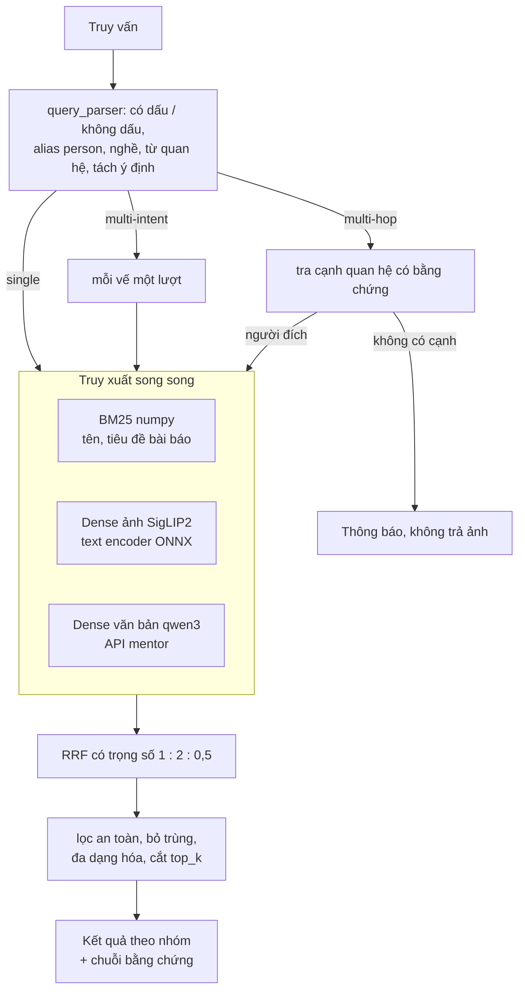
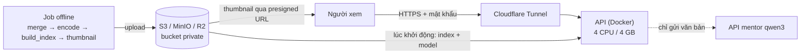

# Image Data Processing & Retrieval: ảnh người nổi tiếng Việt Nam

Capstone cá nhân (Dương Văn Kiên). Hệ thống tìm ảnh người nổi tiếng Việt Nam bằng câu tiếng Việt tự nhiên, có dấu hoặc không dấu, trên **90.056 ảnh**. Trọng tâm là **Phần B: truy xuất ảnh**. Phần A (kiểm duyệt ảnh) là future work, xem [part_a/](part_a/README.md).

Mọi số liệu gắn nhãn **[Đã đo]** (đo thật, ghi điều kiện) hoặc **[Ước tính]**.

## Kết quả chính

| Hạng mục | Kết quả |
|---|---|
| Dữ liệu | 92.140 dòng CSV đã duyệt → **90.056 ảnh**, 8.029 entity gộp thành **5.653 person** [Đã đo] |
| Loại truy vấn | single-intent, multi-intent, multi-hop (quan hệ có bằng chứng) |
| Chất lượng (split test, 79 truy vấn, chạy một lần) | hành vi đúng 77/79, P@10 0,87, nDCG@10 0,92, MRR 0,96; multi-hop bịa 1/23 [Đã đo] |
| Latency HTTP (Docker 4 CPU / 4 GB, k6) | p95 332 ms ở 1 VU, 1,6 s ở 16 VU; **p95 < 3 s ở mọi mức tải đã đo**, 0% lỗi [Đã đo] |
| Thông lượng | 20 QPS với cấu hình mặc định, 31 QPS khi tắt kênh văn bản của mentor [Đã đo] |
| Triển khai | Docker Compose (API + MinIO); bản public chạy trên Cloudflare R2 + Cloudflare Tunnel, có mật khẩu |
| CI | GitHub Actions: ruff, 328 test, build image Docker |

## Demo

- **Bản public**: link `*.trycloudflare.com` và mật khẩu được gửi riêng. Trình duyệt sẽ hỏi tên và mật khẩu; tên gõ gì cũng được. Link chỉ sống khi máy chủ (laptop) đang bật.
- **Chạy trên máy với dữ liệu giả** (không cần dữ liệu thật, khoảng 5 phút):

  ```bash
  cd part_b
  python -m venv .venv && . .venv/Scripts/activate   # Linux/macOS: . .venv/bin/activate
  cp .env.example .env && python -m pip install -e ".[dev]"
  python scripts/build_index.py --input tests/fixtures/mini --version dev
  cd web && npm install && npm run build && cd ..
  uvicorn imgsearch.api.main:app                     # http://localhost:8000
  ```

Ví dụ truy vấn:

| Loại | Ví dụ | Hệ thống làm gì |
|---|---|---|
| Single-intent | "Đen Vâu", "Đặng Văn Lâm bắt bóng", "hoa hậu đội vương miện" | Nhận người hoặc chủ đề, xếp ảnh theo phần mô tả |
| Multi-intent | "Trấn Thành và Hari Won" | Mỗi vế một nhóm, thêm nhóm ảnh hai người xuất hiện cùng nhau |
| Multi-hop | "vợ của Trấn Thành", "con trai Phạm Nhật Vượng" | Đi theo cạnh quan hệ **có bằng chứng** (tiêu đề + link bài báo) rồi trả ảnh người đích. Không có bằng chứng thì báo không có và **không trả ảnh** |

## Kiến trúc

Truy xuất lai: phân tích truy vấn bằng quy tắc, liên kết person, ba kênh truy xuất chạy song song, gộp bằng RRF, rồi đi trên đồ thị tri thức cho multi-hop. Không dùng tác tử LLM vì chậm và dễ bịa quan hệ.



| Thành phần | Công nghệ |
|---|---|
| API | FastAPI: `/search` (header `Server-Timing` theo từng bước), `/healthz`, `/metrics` |
| Từ khóa | BM25 tự viết bằng numpy, mỗi từ có cả dạng có dấu và không dấu |
| Dense ảnh | SigLIP2 ViT-B/32. Ảnh mã hóa offline bằng torch; truy vấn mã hóa bằng ONNX Runtime (image API không có torch) |
| Dense văn bản | qwen3-embedding-4b qua API của mentor; lỗi hoặc quá giới hạn thì tự bỏ kênh này |
| Lưu trữ | `meta.sqlite` (metadata + đồ thị tri thức) + ma trận `.npz`; index có phiên bản trên S3 / MinIO / R2 |
| Web | HTML + TypeScript thuần, hiển thị nhóm, chuỗi bằng chứng và thời gian từng bước |

Quyết định thiết kế chính, mỗi quyết định có số đo [Đã đo]:
- **BM25 numpy thay SQLite FTS5**: 4–6 ms so với 100–150 ms mỗi truy vấn trên 80k ảnh.
- **Không dùng FAISS**: 90k vector chỉ là một phép nhân ma trận numpy.
- **Text encoder ONNX fp32, không int8**: int8 lệch quá xa (cosine 0,83–0,94 so với fp32).
- **Giới hạn 2 truy vấn tính toán đồng thời**: không giới hạn thì thông lượng sụp từ 33,9 xuống 16,6 QPS khi tăng tải.
- **Bỏ reranker**: không có caption thì reranker làm nDCG@10 giảm từ 0,64 xuống 0,44.

Chi tiết và số đo cho từng quyết định: [docs/architecture.md](docs/architecture.md).

## Đánh giá

Test set gồm 161 truy vấn (`part_b/testsets/`), chia **dev 82 / test 79**:
- **Sinh tự động** từ dữ liệu: tên, không dấu, trùng tên, tên bịa, multi-intent, multi-hop.
- **Viết tay**: 32 truy vấn bối cảnh, chấm tay 0/1/2 trên 1.344 ảnh.

Mọi tham số chỉ tinh chỉnh trên dev; **split test chạy đúng một lần**, sau khi đã chốt cấu hình.

| Split | Hành vi đúng | P@10 | R@50 | nDCG@10 | MRR |
|---|---|---|---|---|---|
| dev | 80/82 | 0,89 | 0,93 | 0,94 | 0,97 |
| **test** | **77/79** | **0,87** | **0,89** | **0,92** | **0,96** |

Theo loại truy vấn (test): single 40/41 (nDCG@10 0,87); multi-intent 15/15 (nDCG@10 0,95); multi-hop 22/23, người gốc đúng 23/23, bịa 1/23 [Đã đo].

Ablation trên truy vấn bối cảnh (nDCG@10, test): chỉ BM25 0,70 → BM25 + ảnh 0,80 → **thêm kênh văn bản 0,81**. Dense ảnh đóng góp nhiều nhất vì dữ liệu không có caption [Đã đo].

Báo cáo đầy đủ, kèm danh sách lỗi còn lại: [reports/eval.md](reports/eval.md).

## Hiệu năng

Đo bằng k6 qua HTTP: container API giới hạn 4 CPU / 4 GB, 100 truy vấn trộn (50% single, 30% multi-intent, 20% multi-hop), 1/4/8/16 VU, mỗi mức 60 s, tắt cache vector truy vấn. Máy đo: Intel Core Ultra 7 155H, không GPU [Đã đo].

| Cấu hình | QPS đỉnh (p95 < 3 s) | p95 ở 1 VU | p95 ở 16 VU | RAM API |
|---|---|---|---|---|
| BM25 + ảnh + văn bản (mặc định) | 20,1 | 332 ms | 1.572 ms | 2,2 GB |
| BM25 + ảnh (tắt kênh mentor) | 31,2 | 159 ms | 926 ms | 1,8 GB |

- Thời gian xử lý trong engine (một luồng, không tính HTTP): p95 45 ms khi không có kênh mentor. Phần chênh còn lại so với HTTP là lời gọi mạng tới API mentor.
- Khởi động tới khi `/healthz` trả 200: 9–14 s (tải index từ MinIO, nạp model).
- Benchmark chạy lại bằng một lệnh: `python bench/run_bench.py`, sinh [reports/perf.md](reports/perf.md).

## Triển khai



- **Local** (`part_b/docker-compose.yml`): `minio` (object storage), `init` (tạo bucket, đẩy thumbnail rồi index), `api` (tải index từ MinIO về volume cache rồi nạp). Image API dùng Python 3.12 slim, multi-stage (web build ở stage Node riêng), chạy bằng user thường, có healthcheck.
- **Public** (`part_b/docker-compose.public.yml`): API chạy trên laptop đã benchmark, tải index, model và danh sách thumbnail từ **Cloudflare R2** (bucket private, ~2,6 GB, trong mức miễn phí). Ra Internet qua Cloudflare quick tunnel. Thumbnail WebP 320 px đi thẳng từ R2 tới trình duyệt bằng presigned URL.
- **An toàn khi public**:
  - mật khẩu dùng chung (HTTP Basic); gửi sai quá 10 lần/phút thì IP bị chặn một phút;
  - giới hạn 30 truy vấn/phút mỗi IP;
  - lọc an toàn luôn bật, client không tắt được;
  - truy vấn tìm ảnh nhạy cảm của người thật bị từ chối và ghi log.

Lệnh chạy từng bước: [part_b/README.md](part_b/README.md) mục 3 (Docker) và mục 4 (bản public).

## CI/CD

- **CI** ([.github/workflows/ci.yml](.github/workflows/ci.yml)) chạy mỗi lần push `main` hoặc mở pull request:
  1. `ruff check` và `ruff format --check`;
  2. `pytest`: 328 test trên dữ liệu giả `tests/fixtures/mini/`, không cần dữ liệu thật hay key;
  3. build image Docker (có cache của GitHub Actions); image không được push lên registry.
- **CD**: chưa tự động. Dữ liệu là ảnh người thật và index dựng offline trên máy có dữ liệu, nên việc phát hành gồm hai bước tay:
  1. `python -m imgsearch.storage.s3 --env-file .env.r2 ...`: đẩy index, thumbnail và model lên R2;
  2. `docker compose -f docker-compose.public.yml up -d --build`: chạy bản public.

  Index có phiên bản (`index/v{INDEX_VERSION}/`), nên đổi phiên bản chỉ cần đổi biến môi trường.
- **Quy trình làm việc**: mỗi tính năng làm trên một nhánh `feat/*`, commit nhỏ (mỗi module kèm test của nó), rồi fast-forward vào `main`.

## Cấu trúc repo

```
part_b/      truy xuất ảnh: package imgsearch, API, web, Docker, benchmark, test set
  src/imgsearch/   api, retrieval, kg, data, eval, storage, text
  tests/           328 test, dữ liệu giả ở tests/fixtures/mini/
  testsets/        test set JSONL, nhãn chấm tay, truy vấn benchmark
  bench/  scripts/  web/
part_a/      kiểm duyệt ảnh: future work (chỉ README)
capstone/    PLAN.md (kế hoạch, phương án), SCENARIOS.md (kịch bản người dùng có mã)
docs/        architecture.md: tài liệu kỹ thuật đầy đủ
reports/     eval.md (đánh giá dev + test), perf.md (benchmark)
data/  models/   dữ liệu và model ONNX, không commit (README mô tả định dạng)
```

## Hạn chế chính

- **Dữ liệu không có caption VLM**: truy vấn mô tả cảnh dựa vào tiêu đề bài báo và dense ảnh. Model ảnh không hiểu một số khái niệm Việt (ví dụ "áo dài").
- **Gộp person chỉ dựa trên tên**: còn person bị tách đôi ("Hà Hồ" / Hồ Ngọc Hà), ảnh gần trùng vẫn hiện hai lần, lọc ảnh nhạy cảm chưa có điểm để lọc. Cả ba cần Phần A (khuôn mặt, dedupe, điểm kiểm duyệt).
- **Đồ thị tri thức nhỏ**: 28 cạnh từ tiêu đề bài báo, ưu tiên độ chính xác. Còn 1 cạnh sai đã biết; chưa có Wikidata và multi-hop 2 bước.
- **Kênh văn bản phụ thuộc API mentor**: giới hạn 100 request/phút; lỗi thì tự quay về BM25 + ảnh.
- **Bản public chạy trên laptop**: URL đổi mỗi lần chạy, mật khẩu dùng chung cho mọi người.

Danh sách đầy đủ và hướng mở rộng (quy mô 10–100M ảnh, caption VLM, Wikidata): [docs/architecture.md](docs/architecture.md) mục 8–9.

## Quyền riêng tư

Dữ liệu là ảnh người thật: không commit ảnh, CSV, embedding, index hay model. Bucket để private, ảnh hiển thị qua presigned URL có hạn. Kênh văn bản chỉ gửi văn bản (tiêu đề, tên) cho API mentor, không gửi ảnh. Hệ thống không có chức năng tìm bằng ảnh khuôn mặt.

## Tài liệu

| Tài liệu | Nội dung |
|---|---|
| [docs/architecture.md](docs/architecture.md) | Kiến trúc, quyết định kèm số đo, đánh giá, hiệu năng, triển khai, hạn chế |
| [part_b/README.md](part_b/README.md) | Cách chạy lại từ đầu: dữ liệu giả, dữ liệu thật, Docker, bản public, đánh giá |
| [reports/eval.md](reports/eval.md), [reports/perf.md](reports/perf.md) | Báo cáo đánh giá và benchmark |
| [capstone/PLAN.md](capstone/PLAN.md), [capstone/SCENARIOS.md](capstone/SCENARIOS.md) | Kế hoạch ban đầu và kịch bản người dùng |
| [part_a/README.md](part_a/README.md) | Phần A: future work và cách nối vào Phần B |
