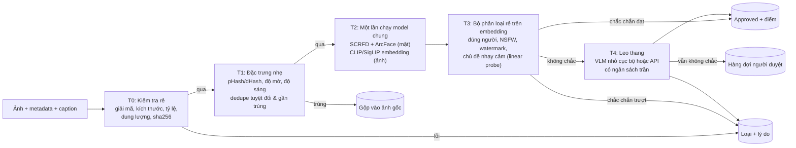
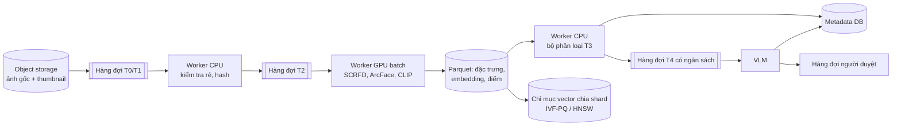
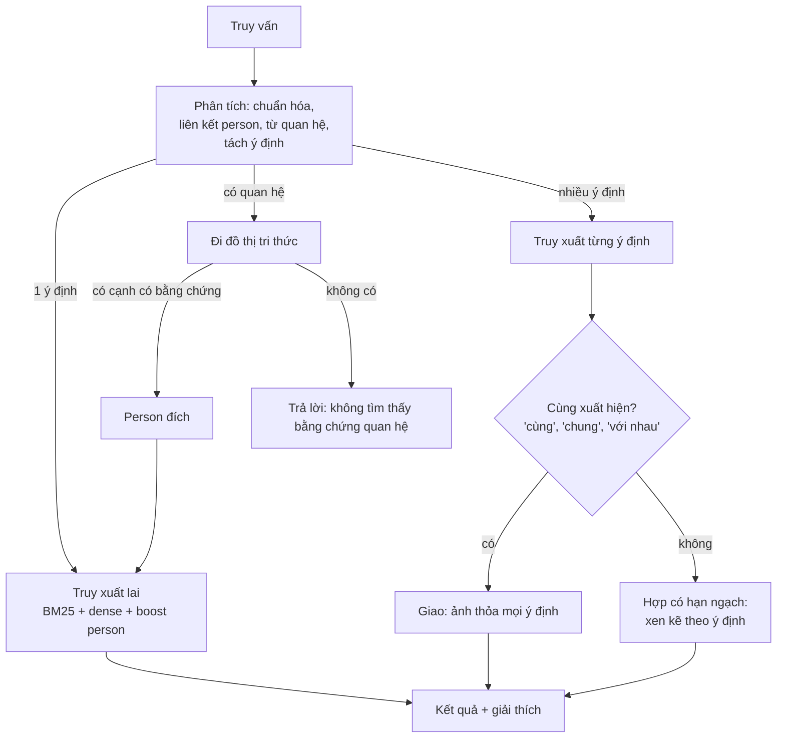
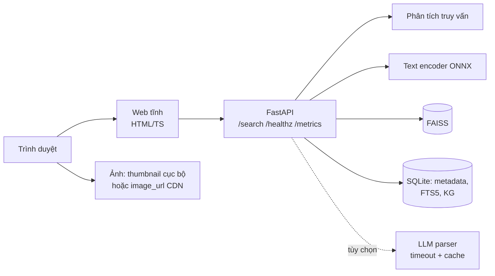
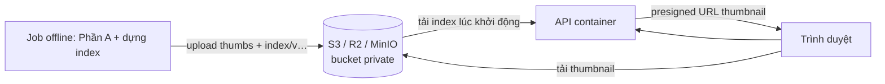

# Kế hoạch Capstone: Image Data Processing & Retrieval

Lập ngày 16/10/2026, hạn nộp 22/10/2026 (còn khoảng 6 ngày). Làm cá nhân.

Ký hiệu dùng trong tài liệu:
- **[Đã đo]**: số liệu lấy từ dữ liệu hoặc máy thật.
- **[Ước tính]**: suy ra hoặc ngoại suy, chưa đo; phải đo lại trước khi đưa vào báo cáo.
- **[Cần xác nhận]**: phải hỏi mentor hoặc team lead.

---

## 0. Điều chỉnh so với đề bài và master prompt

Đề bài viết theo ví dụ địa điểm (Nha Trang, Phú Quốc). Dữ liệu thực tế và những gì đã thống nhất khác ở các điểm sau, nên kế hoạch được điều chỉnh như dưới.

| Điểm trong đề / master prompt | Thực tế | Điều chỉnh |
|---|---|---|
| Ảnh crawl tùy ý, chưa duyệt | Tập ảnh **người nổi tiếng Việt Nam** của 6 batch, cả team **đã duyệt tay** (approved/rejected + lý do) | Phần A có sẵn ground truth thật để đo; ảnh rejected giữ lại làm tập đánh giá, không đưa vào index |
| Không giả định có caption | Mentor sẽ cấp lại dữ liệu **kèm caption do VLM sinh** | **Truy xuất dựa trên caption là chính** (embed văn bản nhanh, không cần tải ảnh); embedding ảnh thành tùy chọn, chỉ thêm nếu đo thấy caption bỏ sót nhiều. Vẫn đo chất lượng caption và có dự phòng nếu caption đến muộn hoặc kém |
| Chọn lọc theo **địa điểm**, người duyệt thiếu kiến thức về địa điểm | Bài toán tương đương là chọn lọc **đúng người / đúng entity**, người duyệt không biết mặt người đó | So khớp khuôn mặt với ảnh tham chiếu đã duyệt thay cho "kiến thức chuyên môn"; thêm bài toán **gộp entity trùng người** |
| Đủ 80.000 ảnh? | Ảnh gốc approved khoảng 60.000 [Ước tính] + ảnh crawl đã duyệt khoảng 18.000 (Kiên) + gần 20.000 (đồng đội) | Đủ, dư khoảng 15–20k trước dedupe; vẫn phải đếm lại sau khi gộp |
| Ví dụ truy vấn về địa điểm | Dữ liệu toàn ảnh người | Test case viết lại theo người, sự kiện, bối cảnh; giữ ví dụ multi-hop "con trai chủ tịch Phạm Nhật Vượng" vì dữ liệu có các entity liên quan |
| Phần cứng không nêu | Laptop Intel Core Ultra 7 155H (16 nhân, 22 luồng), RAM 32 GB, GPU tích hợp Intel Arc, không có GPU NVIDIA [Đã đo] | Suy luận chạy CPU (ONNX Runtime / OpenVINO); tính embedding hàng loạt có thể chuyển sang GPU miễn phí (Kaggle/Colab) |

---

## 1. Hiện trạng dữ liệu và tài sản sẵn có

### 1.1 Số liệu dữ liệu [Đã đo]
- 5 file `approved-results (1..5).csv` có tổng khoảng 74.700 dòng, **7.696 tên entity khác nhau**. Phân bố theo tên entity: singer 1.530, celeb 1.423, athletes 1.343, historic 930, politicer 878, businessman 703, scientist 467, writer 422.
- Cột có sẵn: `entity_id, slug, canonical_name, category, kind_hint, query, local_path, sha256, image_url, source_url, source_domain, description, width, height, bytes, crawled_at, has_face, face_count, face_area_pct, cluster, flag` (file 4–5 có thêm `watermark, watermark_score, duplicated` nhưng đang để trống).
- `description` là **tiêu đề bài báo nguồn** (ví dụ "Rapper 16 Typh xin lỗi, lên tiếng về tin đồn…"), là nguồn văn bản yếu nhưng miễn phí cho truy xuất và cho bằng chứng quan hệ.
- `image_url` trỏ tới CDN của mentor, có thể dùng để hiển thị ảnh mà không phải tự lưu trữ [Cần xác nhận được phép hotlink].

### 1.2 Phát hiện quan trọng: entity bị phân mảnh
Cùng một người bị tách thành nhiều entity mang tên mô tả, ví dụ Phạm Nhật Vượng có các entity "Chân dung studio Phạm Nhật Vượng Forbes", "Doanh nhân Phạm Nhật Vượng phát biểu tại sự kiện VinFast", "Headshot doanh nhân Phạm Nhật Vượng"…; Hồ Ngọc Hà, Sơn Tùng M-TP, Đen Vâu, Trấn Thành cũng vậy. Có cả entity nhóm như "Gia đình Trấn Thành – Hari Won du lịch Hàn Quốc".
**Hệ quả:** nếu không gộp entity thành "người" (person), truy vấn tên người sẽ bỏ sót ảnh, và multi-hop không có nút để đi. Gộp entity là việc **bắt buộc**, thuộc Phần A.

### 1.3 Nhãn người duyệt và baseline tự động [Đã đo]
Trên 18.188 ảnh thuộc phần của Kiên (batch 2–5) có cả gợi ý tự động (`auto_flag`) của pipeline hiện tại và nhãn cuối của người:

| Gợi ý tự động | Số ảnh | Người duyệt đồng ý |
|---|---|---|
| suggest_approved | 12.089 | 11.338 approved (93,8%) |
| rejected | 1.174 | 1.051 rejected (89,5%) |
| to_review | 4.925 (27,1%) | 3.621 approved, 1.304 rejected |

Pipeline hiện tại **tự quyết được 72,9% ảnh với độ đúng 93,4%**, 27,1% còn lại phải người xem. Lý do reject: wrong_person 2.703, name_mismatch 762, not_clear 201, not_prominent 61, sensitive 50, no_person 45.
Đây là **baseline thật** để Phần A chứng minh cải tiến. Số nhãn `sensitive` rất ít (50 ở tập này, khoảng 115 ở các tập crawl), không đủ để đo mô-đun kiểm duyệt nội dung.

### 1.4 Mã và công cụ dùng lại được
- Tải ảnh có sha256, dHash, thử lại mạng (`download_scope.py`, `run_batches.py`).
- SCRFD + ArcFace bằng ONNX trên CPU (`extract_faces.py`), đã có embedding mặt cho một số batch (`features/embeddings.f32`).
- Rule + gom cụm mặt (`apply_rules.py`), phễu crawl có số liệu từng tầng (`crawl_funnel.py`).
- Trang duyệt HTML offline (dùng lại để gán nhãn test case và đánh giá liên quan).
- Hỗ trợ Wikidata/Commons (`crawl_wikimedia.py`), dùng lại cho liên kết entity.

---

## 2. Mục tiêu và phạm vi

| Mức | Hạng mục | Điều kiện coi là xong |
|---|---|---|
| **Bắt buộc** | Dữ liệu hợp nhất ≥ 80.000 ảnh, dedupe, schema | Script chạy lại được, ra số đếm cuối |
| ~~Bắt buộc~~ Future work (21/10/2026) | Phần A: pipeline nhiều tầng có số đo độ chính xác, thông lượng, chi phí | Không làm trong capstone; thiết kế giữ ở mục 3, hạn chế và cách nối ở [part_a/README.md](../part_a/README.md) |
| Bắt buộc | Phần B: single, multi-intent, multi-hop chạy được trên toàn bộ index | Test set + điểm đánh giá từng loại |
| Bắt buộc | Latency < 3 s đo trên 80.000 ảnh, có throughput | Báo cáo p50/p95/p99 + cách đo |
| Bắt buộc | Web demo, Dockerfile, docker compose, README, tài liệu có sơ đồ | Người khác clone và chạy được |
| Nên có | Load test k6/Locust tự sinh báo cáo; Docker multi-stage, healthcheck | Một lệnh chạy lại benchmark |
| Có thì tốt | Demo public có tên miền; CI/CD GitHub Actions | Chỉ làm khi phần bắt buộc đã ổn |

---

## 3. Phần A: Xử lý và kiểm duyệt ảnh

> **Cập nhật 21/10/2026:** Phần A chuyển thành future work, không triển khai trong capstone. Mục này giữ làm thiết kế cho bước tiếp theo; xem [part_a/README.md](../part_a/README.md).

### 3.1 Bài toán trên dữ liệu người
1. **Chất lượng kỹ thuật:** ảnh lỗi, độ phân giải, tỷ lệ khung hình, nén nặng, mờ.
2. **Trùng lặp:** trùng tuyệt đối, gần trùng (resize, crop, nén lại), trùng giữa nhiều entity.
3. **Chọn lọc đúng người** (tương đương "chọn lọc theo địa điểm"): ảnh có đúng người của entity, người đó có nổi bật trong ảnh không. Kèm **gộp entity thành person**.
4. **Watermark / chữ chèn.**
5. **Nội dung nhạy cảm:** khiêu dâm, hở hang; bạo lực.
6. **Chính trị / phản động:** theo chính sách do mentor quy định.
7. Chi phí thấp, mở rộng được tới 10–100M ảnh, có số liệu chứng minh.

### 3.2 Tiêu chí nào tự động được, tiêu chí nào cần người

| Tiêu chí | Tự động quyết định? | Lý do |
|---|---|---|
| Ảnh lỗi, độ phân giải, tỷ lệ khung hình, dung lượng | Có, hoàn toàn | Quy tắc xác định, không mơ hồ |
| Trùng tuyệt đối (sha256) | Có | Chính xác tuyệt đối |
| Gần trùng (pHash/embedding) | Có, với ngưỡng chặt; vùng giữa cho người | Có ca biến thể hợp lệ (cùng buổi chụp khác khung) |
| Mờ, tối | Có, theo ngưỡng; ghi điểm thay vì loại cứng | Ảnh tư liệu cũ mờ nhưng có giá trị |
| Đúng người | Tự động ở vùng chắc chắn; vùng giữa cho người | Baseline cho thấy 27% ảnh cần người |
| Watermark | Tự động gắn điểm; loại cứng chỉ khi điểm cao | Logo báo chí nhỏ ở góc thường chấp nhận được, phụ thuộc chính sách |
| Khiêu dâm rõ ràng | Tự động loại khi điểm rất cao | Mô hình chuyên biệt khá tốt ở ca rõ ràng |
| Hở hang mức nhẹ, nhạy cảm | Gắn cờ, người quyết | Ranh giới phụ thuộc văn hóa và chính sách |
| Chính trị / phản động | **Chỉ phân loại sơ bộ**, người quyết | Không có mô hình sẵn đáng tin; ảnh chính khách là nội dung hợp lệ |

### 3.3 Pipeline nhiều tầng



Nguyên tắc: **mỗi ảnh chỉ chạy model nặng một lần (T2)**, các quyết định sau dùng lại embedding đó. Nếu Phần B cũng dùng embedding ảnh thì dùng chung embedding này.

Caption của VLM là tín hiệu bổ trợ cho T3 (từ khóa nhạy cảm, mô tả có chữ/logo), nhưng **không thay được tầng chạy trên ảnh**: kiểm duyệt dựa vào caption chỉ tốt bằng việc VLM có mô tả chuyện đó hay không, còn kiểm tra đúng người và gần trùng bắt buộc phải nhìn ảnh.

### 3.4 Phương án cho từng khối

#### A1. Chất lượng kỹ thuật
| Phương án | Ưu | Nhược | Chi phí |
|---|---|---|---|
| Quy tắc (PIL/OpenCV): giải mã, cạnh nhỏ nhất, tỷ lệ, byte/pixel, Laplacian variance | Rất nhanh, giải thích được | Không bắt được "ảnh xấu" về thẩm mỹ | Rất thấp |
| IQA học sẵn (NIMA, MUSIQ…) | Đánh giá cảm quan tốt hơn | Thêm model, chậm hơn, ngưỡng khó chọn | Trung bình |
| Linear probe thẩm mỹ trên embedding CLIP (kiểu LAION aesthetic) | Gần như miễn phí khi đã có embedding | Thiên lệch theo dữ liệu huấn luyện gốc | Rất thấp |

**Đề xuất:** quy tắc làm cổng cứng; điểm thẩm mỹ trên embedding chỉ dùng để xếp hạng, không loại.

#### A2. Trùng lặp
| Phương án | Bắt được | Nhược |
|---|---|---|
| sha256 | Trùng byte | Bỏ sót ảnh resize/nén lại |
| pHash/dHash + Hamming ≤ ngưỡng | Resize, nén lại, chỉnh nhẹ | Kém với crop mạnh, ghép ảnh |
| Cosine embedding ≥ ngưỡng (FAISS) | Crop, đổi màu, thêm viền chữ | Có thể gộp nhầm ảnh cùng buổi chụp |

**Đề xuất:** dùng cả ba theo thứ tự rẻ → đắt. Ảnh trùng giữa entity không xóa mà lưu quan hệ nhiều–nhiều `image_entity`. Đo: số cặp trùng mỗi tầng, kiểm tra tay 100 cặp ở vùng ngưỡng để ước lượng precision.

#### A3. Chọn lọc đúng người và gộp entity
**Đúng người**
| Phương án | Ưu | Nhược |
|---|---|---|
| (a) Rule + ArcFace + gom cụm hiện tại | Đã có, đã đo: tự quyết 72,9%, đúng 93,4% | Ngưỡng đặt tay; 27% còn phải người xem |
| (b) **Bộ hiệu chỉnh học từ nhãn** (logistic regression / gradient boosting) trên đặc trưng sẵn có: cosine tới tâm entity, kích thước cụm, diện tích mặt, số mặt, độ nét, khớp tên trong `description` | Rẻ, dùng 18k+ nhãn thật; chọn điểm vận hành theo precision mục tiêu (ví dụ 98%) và đo độ phủ tương ứng | Cần chia train/test theo entity để không rò rỉ |
| (c) CLIP/SigLIP zero-shot theo tên người | Không cần ảnh tham chiếu | Gần như chắc chắn kém với người nổi tiếng Việt Nam; chỉ nên chạy để chứng minh bằng số |
| (d) VLM làm giám khảo | Hiểu bối cảnh | Đắt, dễ bịa danh tính, không scale |

**Đề xuất:** (b) là cải tiến chính của Phần A, so sánh trực tiếp với (a) trên cùng tập test; (d) chỉ cho phần nhỏ ở T4.

**Gộp entity thành person**
| Phương án | Ưu | Nhược |
|---|---|---|
| Chuẩn hóa tên: bỏ cụm mô tả ("Chân dung studio", "Doanh nhân", "(Forbes)"…), bỏ dấu, so khớp mờ | Nhanh | Nhầm người trùng tên (có 2 "Sơn Tùng": ca sĩ và nhà văn) |
| Khoảng cách giữa tâm ArcFace của các entity | Bắt được cùng người khác tên | Entity ít ảnh có tâm nhiễu |
| Liên kết Wikidata (QID) | Có ID chuẩn và alias | Độ phủ người Việt Nam hạn chế |
| **Kết hợp:** ứng viên từ tên → xác nhận bằng mặt (cosine tâm) và category → gán person_id; vùng không chắc để người xem | Cân bằng độ chính xác và công sức | Cần một lượt duyệt tay nhỏ |

Đo: số entity → số person; kiểm tra tay khoảng 100 cặp gộp để tính precision.

#### A4. Watermark
| Phương án | Ưu | Nhược |
|---|---|---|
| Mô hình watermark công khai (ví dụ bộ phát hiện watermark LAION) | Có sẵn | Huấn luyện trên dữ liệu khác, cần kiểm tra lại license và độ chính xác trên ảnh báo Việt Nam |
| OCR phát hiện vùng chữ (RapidOCR/PaddleOCR ONNX), đo tỷ lệ diện tích chữ, vị trí góc | Giải thích được, bắt cả chữ chèn | Chậm hơn nhiều; không bắt logo không chữ |
| **Linear probe trên embedding** với 300–500 ảnh tự gán nhãn | Gần như miễn phí khi chạy | Phải tự gán nhãn; ít dữ liệu |

**Đề xuất:** linear probe làm tầng chính, OCR chỉ chạy cho ảnh điểm vùng giữa. Gán nhãn bằng trang duyệt sẵn có.

#### A5. Nội dung khiêu dâm / hở hang
| Phương án | Ưu | Nhược |
|---|---|---|
| Bộ phân loại NSFW chuyên biệt (ví dụ ViT fine-tune công khai, OpenNSFW2) | Nhanh, tốt với ca rõ ràng | Một ngưỡng nhị phân, khó phân mức |
| Bộ phát hiện bộ phận (NudeNet) | Chi tiết, giải thích được | Chậm hơn, cần quy tắc tổng hợp |
| Linear probe / zero-shot trên embedding CLIP | Miễn phí khi đã có embedding | Kém hơn model chuyên biệt ở ca biên |
| Mô hình an toàn ảnh dạng VLM (ví dụ ShieldGemma 2) | Theo chính sách mô tả bằng chữ | Nặng, chỉ hợp với T4 |

**Đề xuất:** probe trên embedding ở T3 cho mọi ảnh; model chuyên biệt chỉ chạy cho ảnh vượt ngưỡng thấp. **Vấn đề đánh giá:** dữ liệu gần như không có ảnh khiêu dâm (chỉ khoảng 165 nhãn `sensitive`, nghĩa chưa thống nhất), nên recall phải đo trên một tập đánh giá công khai và ghi rõ giới hạn; không lưu ảnh đó vào repo.

#### A6. Chính trị / phản động
- Không có mô hình sẵn đáng tin, và trong tập người, ảnh chính khách (878 tên entity `politicer`) là nội dung hợp lệ.
- Tín hiệu rẻ: từ khóa trong caption và `description`, danh sách nguồn (`source_domain`), khái niệm thị giác qua zero-shot (cờ, biểu ngữ, đám đông biểu tình, vũ khí, bản đồ), chính sách theo entity [Cần xác nhận danh sách từ mentor].
- Hệ thống **chỉ gắn cờ và đưa vào hàng đợi người**, không tự loại. Đo: recall trên tập nhỏ tự gán nhãn, và tỷ lệ ảnh bị gắn cờ (chi phí công người).

#### A7. Tầng leo thang (T4)
| Phương án | Ưu | Nhược |
|---|---|---|
| VLM nhỏ cục bộ (Qwen2.5-VL-3B, SmolVLM, Florence-2…) | Không tốn API, dữ liệu không ra ngoài | Chậm trên CPU; cần GPU để có thông lượng |
| API VLM thương mại (ví dụ Claude Haiku/Sonnet) | Chất lượng cao, không cần hạ tầng | Tốn tiền theo token, gửi ảnh ra ngoài |
| Không có T4, đẩy thẳng cho người | Đơn giản, đúng nhất | Tốn công người |

**Đề xuất:** đặt **ngân sách trần**, ví dụ chỉ ≤ 1–3% ảnh vào T4. Trong 6 ngày, đo trên một mẫu nhỏ (ví dụ 200 ảnh to_review) để có số chính xác và chi phí thật, rồi ngoại suy.

### 3.5 Thực nghiệm cần chạy
| Thực nghiệm | Dữ liệu | Chỉ số |
|---|---|---|
| Baseline vs bộ hiệu chỉnh (A3) | 18.188 ảnh có nhãn, chia train/test theo entity | Độ phủ tự động tại precision 95/98/99%, accuracy, số ảnh còn cho người |
| Dedupe | Toàn bộ tập hợp nhất | Số cặp mỗi tầng, precision trên 100 cặp kiểm tra tay |
| Gộp entity | 7.696 tên | Số person, precision trên 100 cặp |
| Watermark, NSFW, nhạy cảm | Tập tự gán nhãn nhỏ + tập công khai | Precision, recall, PR-AUC, ngưỡng vận hành |
| Thông lượng từng tầng | Mẫu 2.000 ảnh, cùng máy | ảnh/giây, CPU vs OpenVINO vs GPU Kaggle |
| T4 | 200 ảnh khó | Độ đúng, giây/ảnh, chi phí/ảnh |

### 3.6 Mô hình chi phí và ngoại suy 10–100M ảnh
Chi phí cho N ảnh:

```
Chi_phí(N) = N × Σ_i  f_i × c_i
  f_i = tỷ lệ ảnh đi tới tầng i (đo trên dữ liệu thật)
  c_i = chi phí/ảnh ở tầng i = giá_máy_mỗi_giờ / (thông_lượng_ảnh_mỗi_giây × 3600)
```

- So sánh với phương án đề bài muốn thay thế (mọi ảnh qua VLM lớn): `N × (token_vào × giá_vào + token_ra × giá_ra)`. Giá lấy từ trang giá chính thức tại ngày viết báo cáo; số token ảnh tính theo công thức trong tài liệu của nhà cung cấp.
- Ghi rõ trong báo cáo: f_i và thông lượng **[Đã đo]** trên mẫu; giá máy và kết quả 10–100M **[Ước tính]**.
- Lưu ý: ở quy mô lớn, tải ảnh và giải mã thường chiếm phần lớn thời gian, không phải model; phải đo riêng.

### 3.7 Kiến trúc mở rộng (chỉ thiết kế, không triển khai)



- Khóa idempotent là sha256: chạy lại không làm lại ảnh đã xử lý.
- 100M vector 512 chiều float32 ≈ 200 GB; nén PQ 64 byte/vector ≈ 6,4 GB [Ước tính, tính toán].

---

## 4. Phần B: Truy xuất ảnh

### 4.1 Ba loại truy vấn trên dữ liệu người
| Loại | Ví dụ | Điều hệ thống phải làm |
|---|---|---|
| Single-intent | "Đen Vâu", "Hồ Ngọc Hà mặc áo dài", "vận động viên cầu lông" | Nhận diện người hoặc chủ đề, xếp hạng theo phần mô tả còn lại |
| Multi-intent | "Trấn Thành và Hari Won", "Mỹ Tâm trên sân khấu và Mỹ Tâm thời thơ ấu" | Tách ý định, trả kết quả cân bằng cho từng ý; phân biệt "cùng xuất hiện" và "mỗi người một nhóm" |
| Multi-hop | "ảnh con trai chủ tịch Phạm Nhật Vượng", "ảnh vợ của MC Trấn Thành" | Xác định người gốc, đi theo quan hệ **có bằng chứng**, rồi lấy ảnh người đích; nếu không có bằng chứng thì nói không có |

Dữ liệu có entity "Phạm Nhật Quân Anh" (businessman), nhưng hệ thống không được tự suy quan hệ từ tên; quan hệ phải lấy từ nguồn có bằng chứng (mục 4.5).

### 4.2 Ba hướng kiến trúc tổng thể
| Hướng | Mô tả | Ưu | Nhược | Latency |
|---|---|---|---|---|
| H1. Chỉ dense | Embedding truy vấn → tìm gần nhất trong embedding ảnh | Đơn giản | Kém với tên người Việt, không làm được multi-hop | Rất thấp |
| **H2. Lai + liên kết entity + đồ thị tri thức** | Phân tích truy vấn → liên kết person → lọc/boost → BM25 trên caption/tiêu đề + dense ảnh và văn bản → gộp RRF; multi-hop qua KG | Chính xác với tên, giải thích được, nhanh | Nhiều thành phần hơn | Thấp (dưới 0,5 s nếu không gọi LLM) [Ước tính] |
| H3. Tác tử LLM | LLM tự lập kế hoạch, gọi công cụ tìm kiếm nhiều vòng | Linh hoạt nhất | Chậm, đắt, dễ bịa quan hệ, khó đạt < 3 s ổn định | Cao |

**Đề xuất:** H2. LLM nếu dùng chỉ làm **bộ phân tích truy vấn** có timeout và cache, không bao giờ là nguồn sự thật.

### 4.3 Lựa chọn thành phần

**Thứ tự ưu tiên:** (1) văn bản: caption + tiêu đề bài báo + tên person, (2) liên kết person qua từ điển alias, (3) embedding ảnh chỉ thêm khi so sánh trên cùng test set cho thấy cấu hình "caption + ảnh" tốt hơn rõ rệt so với "chỉ caption".

| | Chỉ caption | Caption + embedding ảnh |
|---|---|---|
| Thời gian index 80k | Vài phút đến khoảng 15 phút trên CPU, không cần tải ảnh [Ước tính] | Thêm khoảng 30–70 phút model trên CPU + tải/giải mã ~25 GB ảnh [Ước tính] |
| Tìm được | Những gì VLM đã mô tả | Thêm chi tiết thị giác VLM bỏ qua |
| Rủi ro | Caption sai hoặc bịa tên → kết quả sai | Phức tạp hơn, image Docker và RAM lớn hơn |

**Embedding ảnh–văn bản (tùy chọn)** (phải hỗ trợ tiếng Việt hoặc có bước dịch)
| Lựa chọn | Ưu | Nhược |
|---|---|---|
| OpenCLIP ViT-B/32 + dịch truy vấn Việt → Anh | Nhẹ, nhanh | Thêm bước dịch, mất sắc thái |
| Multilingual CLIP (text encoder XLM-R) | Hiểu tiếng Việt trực tiếp | Chất lượng ảnh kém hơn model mới |
| SigLIP 2 (đa ngôn ngữ) | Chất lượng tốt, cỡ base vừa phải | Cần kiểm tra chất lượng tiếng Việt |
| jina-clip-v2 | Đa ngôn ngữ, Matryoshka (cắt chiều vector) | Nặng hơn, license phi thương mại |

Chọn bằng **bake-off nhỏ**: 2.000 ảnh, 30 truy vấn có nhãn, đo Recall@10 và thời gian encode; không chọn theo cảm tính.

**Văn bản (caption + tiêu đề + tên):**
- Lexical: BM25 (SQLite FTS5 hoặc thư viện `bm25s`), chuẩn hóa bỏ dấu và giữ dấu song song.
- Dense văn bản: multilingual-e5 (small/base) hoặc BGE-M3; e5-small nhẹ cho CPU, BGE-M3 mạnh hơn nhưng nặng hơn.

**Vector store**
| Lựa chọn | Ưu | Nhược |
|---|---|---|
| **FAISS flat trong tiến trình** | 80k vector tìm chính xác chỉ vài ms; không thêm container | Không có lọc payload sẵn (tự lọc bằng mảng chỉ số) |
| Qdrant | Lọc payload, lưu bền, REST | Thêm một service, thêm RAM |
| pgvector | Gộp metadata và vector một chỗ | Cấu hình, tối ưu chỉ mục tốn thời gian |

Với 80.000 ảnh, tìm chính xác (flat) là đủ và loại bỏ sai số của ANN; phần ngoại suy 100M ghi thiết kế IVF-PQ/HNSW.

**Phân tích truy vấn**
| Lựa chọn | Ưu | Nhược |
|---|---|---|
| **Quy tắc + từ điển alias person** (khớp dài nhất, so khớp mờ bằng rapidfuzz, bỏ dấu) | Vài ms, xác định, kiểm thử được | Không hiểu cách diễn đạt lạ |
| LLM nhỏ cục bộ trả JSON có schema | Linh hoạt, không gửi dữ liệu ra ngoài | Vài giây trên CPU, rủi ro latency |
| API LLM trả JSON có schema | Hiểu tốt | Phụ thuộc mạng, tốn tiền, 0,5–2 s [Ước tính] |

**Đề xuất:** quy tắc trước; chỉ gọi LLM khi quy tắc không phân tích được, timeout 1,5 s, cache theo chuỗi truy vấn, rồi quay về quy tắc nếu hết giờ.

**Gộp và xếp hạng lại:** Reciprocal Rank Fusion (`Σ 1/(60 + hạng)`) để gộp BM25, dense ảnh, dense văn bản; boost ảnh thuộc person đã liên kết. Cross-encoder rerank chỉ thêm nếu còn ngân sách latency.

**Chỉ mục khuôn mặt (tùy chọn):** một vector ArcFace cho mỗi mặt, cho phép "ảnh có cả A và B" bằng cách tìm ảnh có hai mặt khớp tâm của A và B. Hạn chế: ảnh approved phần lớn chỉ có một mặt chính, nên loại truy vấn này ít kết quả.

### 4.4 Luồng xử lý truy vấn



- Multi-intent: hiển thị kết quả **theo nhóm từng ý định** kèm số lượng, tránh một nhóm lấn át. Nếu giao rỗng thì báo và hiển thị từng nhóm.
- Multi-hop: giao diện hiển thị chuỗi suy luận, ví dụ `Phạm Nhật Vượng →(con, nguồn: …)→ <person> → ảnh`, kèm link bằng chứng.

### 4.5 Đồ thị tri thức cho multi-hop
| Nguồn quan hệ | Ưu | Nhược |
|---|---|---|
| **Wikidata** (con P40, vợ/chồng P26, cha P22, mẹ P25, anh chị em P3373, nơi làm việc P108, thành viên P463, đội P54, chức vụ P39) | Có cấu trúc, có ID nguồn, miễn phí | Độ phủ người Việt Nam hạn chế; phải đo |
| Tiêu đề bài báo (`description`) và caption | Có sẵn trong dữ liệu, sát người Việt | Văn bản tự do, dễ trích sai; cần câu bằng chứng |
| Trích bằng LLM offline từ Wikipedia tiếng Việt, mỗi cạnh lưu câu bằng chứng + URL | Phủ rộng hơn | Phải kiểm tra tay; chỉ làm một lần |
| Danh sách tự biên soạn cho test case | Chính xác | Không mở rộng được, phải ghi rõ trong báo cáo |

Số liệu trong dữ liệu [Đã đo]: 4.269/74.666 tiêu đề bài báo (5,7%) chứa từ quan hệ (vợ 1.118, chồng 1.113, mẹ 735, bố 458, con gái 277, con trai 253…). Ví dụ có bằng chứng tốt: "Doanh nhân Phạm Nhật Minh Hoàng - con trai thứ 2 của tỷ phú Phạm Nhật Vượng", "Hari Won gặp áp lực khi lần đầu làm MC cùng ông xã Trấn Thành". Có nhiễu: "Anh trai say hi" là tên chương trình, không phải quan hệ. Caption của VLM chỉ nhìn ảnh nên gần như không chứa quan hệ gia đình; không coi là nguồn quan hệ.

Cách trích từ tiêu đề: mẫu câu ("X - con trai (thứ n) của (tỷ phú|ông|bà) Y", "Y cùng con trai X", "vợ/chồng/ông xã/bà xã của Y") → hai đầu phải liên kết được tới person đã gộp → lưu tiêu đề + `source_url` làm bằng chứng → kiểm tra tay một mẫu để đo precision; cạnh dùng trong test case phải được kiểm tra tay hết.

Quy tắc: **mỗi cạnh phải có `source` và `evidence`**, cạnh không có bằng chứng không được dùng. Báo cáo độ phủ: số person liên kết được Wikidata, số cạnh có cả hai đầu nằm trong dữ liệu.

### 4.6 Ngân sách latency [Ước tính, phải đo]
| Bước | Không LLM | Có LLM |
|---|---|---|
| Phân tích truy vấn (quy tắc) | < 10 ms | 0,5–1,5 s (timeout) |
| Encode văn bản (ONNX CPU) | 10–50 ms | như trên |
| FAISS flat 80k + BM25 | < 20 ms | như trên |
| Đồ thị tri thức + gộp | < 10 ms | như trên |
| **Tổng phía server** | **< 150 ms** | **< 2 s** |

Định nghĩa trong báo cáo: latency truy xuất = thời gian server từ lúc nhận request đến lúc trả JSON (đo bằng header `Server-Timing` theo từng bước); thời gian tải thumbnail trên trình duyệt báo riêng.

---

## 5. Test case, ground truth và đánh giá

### 5.1 Cách tạo test case
| Loại | Cách tạo | Ground truth |
|---|---|---|
| Single (tên người) | Lấy mẫu person phân tầng theo category và số ảnh; biến thể: có/không dấu, alias, sai chính tả nhẹ | **Tự động**: toàn bộ ảnh approved của person (đã được người duyệt) |
| Single (bối cảnh / thuộc tính) | Viết tay từ caption, ví dụ "ca sĩ biểu diễn trên sân khấu" | **Pooling**: gộp top-20 của 2–3 cấu hình hệ thống, gán nhãn 0/1/2 bằng trang duyệt |
| Multi-intent | Ghép 2–3 person (cùng / khác category) hoặc person + bối cảnh; có biến thể "cùng xuất hiện" | Hợp các ground truth thành phần, giữ nhãn theo ý định |
| Multi-hop | Sinh từ các cạnh KG có bằng chứng mà người đích có ảnh; **thêm truy vấn phủ định** (quan hệ không tồn tại / người đích không có ảnh) | Ảnh của person đích; với truy vấn phủ định, đáp án đúng là "không có" |

Quy mô đề xuất: khoảng 60 single, 40 multi-intent, 30 multi-hop + 10 phủ định; chia dev/test, chỉ tinh chỉnh trên dev. Lưu dạng JSONL có phiên bản:
`{id, type, query, intents[], expected_persons[], relation_path[], gt: rule|image_ids, split, notes}`.

### 5.2 Chỉ số
- Chung: Precision@10, Recall@50, nDCG@10, MRR.
- Multi-intent: **độ phủ ý định@10** (tỷ lệ ý định có ≥ 1 kết quả đúng trong top-10), precision theo từng ý định, độ cân bằng (tỷ lệ nhỏ nhất của một ý định trong top-k).
- Multi-hop: độ đúng liên kết người gốc, độ đúng đường quan hệ, P@10 cuối, **tỷ lệ từ chối đúng** ở truy vấn phủ định, **tỷ lệ bịa** (trả ảnh khi không có bằng chứng).

### 5.3 Phân tích lỗi
Ghi log từng bước cho mỗi truy vấn, phân loại lỗi: liên kết người sai, tách ý định sai, thiếu cạnh KG, xếp hạng sai, ground truth sai. Báo cáo bảng số lỗi theo loại và 3–5 ví dụ minh họa.

---

## 6. Benchmark latency và throughput

- **Phần cứng ghi rõ:** CPU, RAM, hệ điều hành, Docker Desktop/WSL2, giới hạn CPU/RAM của container.
- **Kịch bản:** khởi động, chạy 50 truy vấn làm nóng; tắt cache kết quả khi đo (báo cáo riêng số có cache); trộn truy vấn 50% single, 30% multi-intent, 20% multi-hop lấy từ test set.
- **Tải:** k6 (một binary, script JS, xuất JSON/HTML) hoặc Locust (Python). Mức đồng thời 1, 4, 8, 16 người dùng ảo, mỗi mức 60 giây.
- **Chỉ số:** p50/p95/p99 (tính trên toàn bộ request sau làm nóng), QPS, tỷ lệ lỗi, **QPS tối đa mà p95 vẫn < 3 s**, CPU/RAM.
- **Thông lượng index:** ảnh/giây khi tính embedding trên CPU, OpenVINO, GPU Kaggle; thời gian dựng index.
- **Tái lập:** `make bench` (hoặc script) chạy k6, gom kết quả, sinh `reports/perf.md` tự động.

---

## 7. Kỹ thuật

### 7.1 Schema dữ liệu (DBML)

```dbml
Table person {
  person_id varchar [pk]
  name varchar
  aliases text        // JSON, gồm dạng không dấu
  category varchar
  wikidata_qid varchar
}
Table entity {
  entity_id varchar [pk]
  canonical_name varchar
  person_id varchar [ref: > person.person_id]
  merge_method varchar  // name | face | wikidata | manual
}
Table image {
  image_id varchar [pk] // sha256
  image_url varchar
  thumb_path varchar
  width int
  height int
  bytes int
  phash varchar
  caption text          // VLM của mentor
  description text      // tiêu đề bài báo
  source_url varchar
  quality_flags text
  nsfw_score float
  watermark_score float
  sensitive_flag varchar
  status varchar        // approved | rejected | review
  vec_row int           // vị trí trong FAISS
}
Table image_entity {
  image_id varchar [ref: > image.image_id]
  entity_id varchar [ref: > entity.entity_id]
  human_flag varchar
  reject_reason varchar
}
Table relation {
  subj_person varchar [ref: > person.person_id]
  predicate varchar     // child, spouse, parent, sibling, member_of...
  obj_person varchar [ref: > person.person_id]
  source varchar        // wikidata | article | manual
  evidence text
  evidence_url varchar
}
```

Lưu trữ đề xuất: SQLite (metadata, KG, FTS5) + file `.npy`/FAISS cho vector; đủ cho 80k, một file dễ đóng gói. Parquet cho đặc trưng trung gian của Phần A.

### 7.2 Kiến trúc demo



| Quyết định | Phương án A | Phương án B | Đề xuất |
|---|---|---|---|
| Backend | FastAPI (Python) | Go API + service Python cho model | FastAPI: latency bị chi phối bởi model, không phải ngôn ngữ |
| Frontend | HTML + TS thuần, API phục vụ luôn | React/Vite + nginx riêng | TS thuần: ít container, build nhanh |
| Suy luận | ONNX Runtime CPU | PyTorch | ONNX: image nhỏ hơn nhiều, không kéo torch |
| Model trong image | Đóng gói sẵn | Tải lúc khởi động / mount volume | Mount volume khi chạy local; bake khi deploy để khởi động nhanh |
| Hiển thị ảnh | Thumbnail 256 px tự tạo | Hotlink `image_url` | Thumbnail nếu dung lượng chấp nhận được; hotlink làm phương án nhanh [Cần xác nhận] |

### 7.3 Docker
- Multi-stage: stage build cài wheel, stage chạy `python:3.12-slim` chỉ chép môi trường đã cài; không cài torch.
- `HEALTHCHECK` gọi `/healthz` (kiểm tra index đã nạp).
- `docker-compose.yml`: service `api` (kèm web tĩnh), service `minio` (S3 local, bucket thumbnail + index), job `init` upload dữ liệu mẫu vào MinIO, volume cache index; service `bench` (k6) chạy theo profile.
- Ghi số liệu: kích thước image, thời gian build (lạnh/có cache), thời gian khởi động đến khi healthy.

### 7.4 Lưu trữ dữ liệu trên S3 (object storage)

**Lưu gì:** không cần lưu ảnh gốc (~25 GB cho 80k [Ước tính]). Chỉ lưu:
- Thumbnail WebP 256–384 px: khoảng 20–40 KB/ảnh, tức 2–3 GB cho 80k [Ước tính, đo lại khi tạo]. Khóa: `thumbs/{sha256[:2]}/{sha256}.webp`.
- Artefact index có phiên bản: `index/v{ngày}/` gồm `meta.sqlite` (metadata, FTS5, KG), `text.faiss`, (tùy chọn) `image.faiss`, `manifest.json` (model, số ảnh, checksum).
- Dữ liệu trung gian Phần A (Parquet đặc trưng/điểm) và báo cáo benchmark.

| Phương án | Ưu | Nhược |
|---|---|---|
| **MinIO trong docker compose** | API giống S3, chạy local, không tốn tiền, người chấm dựng lại được | Không phải dịch vụ public; dữ liệu nằm trên máy |
| AWS S3 | Chuẩn công nghiệp | Tốn phí truyền dữ liệu ra ngoài; free tier có giới hạn thời gian [kiểm tra khi đăng ký] |
| Cloudflare R2 | API S3, không tính phí egress, có hạn mức miễn phí [kiểm tra hạn mức hiện tại] | Cần tài khoản Cloudflare |
| Backblaze B2 | Rẻ, API S3 | Ít phổ biến hơn |

**Đề xuất:** viết code qua boto3 với `S3_ENDPOINT_URL` cấu hình được, nên cùng một mã chạy với MinIO (local/compose) và R2 hoặc S3 (bản public). Bucket để **private**; ảnh hiển thị qua presigned URL ngắn hạn hoặc qua API proxy, vì là ảnh người thật. Luồng: job offline dựng index → upload `index/v…/` → app đọc biến `INDEX_VERSION`, tải artefact lúc khởi động (cache vào volume), nạp xong mới báo healthy.



### 7.5 Triển khai và CI/CD (có thì tốt)

RAM ước tính cho bản chỉ caption: model văn bản ONNX ~0,5 GB + 80k vector 384 chiều float32 ~120 MB + SQLite vài trăm MB → khoảng 1–1,5 GB [Ước tính, đo lại]. Bản có embedding ảnh cần thêm text encoder CLIP và vector ảnh.

| Phương án | Ưu | Nhược | Hợp với |
|---|---|---|---|
| Local `docker compose` (api + minio) | Bắt buộc theo đề, dễ đo | Không public | Benchmark chính thức |
| Hugging Face Spaces (Docker) | Miễn phí, có URL công khai | Một container (không compose); index phải tải từ S3/R2 lúc khởi động; tài nguyên free tier cần kiểm tra | Demo public nhanh |
| VPS nhỏ (2–4 GB RAM) + domain + Cloudflare | Chạy đúng compose, có tên miền thật | Tốn tiền và thời gian cấu hình, tự lo bảo mật | Điểm cộng "có tên miền" |
| Cloudflare Tunnel từ laptop | Nhanh, chạy đúng máy đã benchmark | Laptop phải bật trong buổi chấm | Phương án dự phòng |

**Đề xuất:** benchmark chính thức trên compose local (MinIO); bản public chọn HF Spaces hoặc VPS với R2 làm kho thumbnail và index. Số latency đo trên máy nào ghi rõ máy đó; không trộn số local với số trên bản public.

CI (GitHub Actions): lint (ruff), unit test (phân tích truy vấn, RRF, chỉ số đánh giá), build Docker có cache, smoke test trên index nhỏ; CD: đẩy image lên GHCR, deploy Space.
**Quyền riêng tư:** ảnh người thật, nên demo công khai cần cân nhắc bật đăng nhập đơn giản; không đẩy dữ liệu ảnh lên GitHub.

---

## 8. Lịch 6 ngày

| Ngày | Việc chính | Đầu ra | Điểm cắt nếu trễ |
|---|---|---|---|
| 16/10 (tối) | Chốt câu hỏi với mentor; gom file nhãn cả team; dựng schema; đếm & dedupe | `data/merged`, số đếm cuối | — |
| 17/10 | Embed caption + tiêu đề (CPU, vài phút); FAISS + BM25 + từ điển person; API single-intent + UI tối thiểu; dựng MinIO trong compose. Chạy nền embedding ảnh trên Kaggle (tùy chọn) | Demo single-intent, latency sơ bộ | Bỏ embedding ảnh |
| 18/10 | Phần A: T0/T1 trên toàn bộ; bộ hiệu chỉnh đúng người trên 18k nhãn; probe NSFW/watermark trên tập nhãn nhỏ; đo thông lượng từng tầng; gộp entity | Bảng kết quả Phần A, mô hình chi phí | Bỏ OCR, bỏ T4 thực nghiệm |
| 19/10 | Multi-intent; KG từ Wikidata + tiêu đề bài báo; multi-hop; test set v1 + script đánh giá | Điểm cả 3 loại truy vấn | Multi-hop chỉ trên tập cạnh biên soạn tay |
| 20/10 | Docker compose, healthcheck; k6; báo cáo perf tự sinh; sửa lỗi theo phân tích lỗi | `reports/perf.md`, `reports/eval.md` | Dùng Locust nếu k6 vướng |
| 21/10 | Tài liệu kỹ thuật, sơ đồ, slide; upload thumbnail + index lên R2/S3, deploy public + CI nếu kịp | Tài liệu + slide, URL demo | Bỏ deploy/CI, demo bằng compose local |
| 22/10 | Chạy lại toàn bộ từ đầu theo README trên máy sạch; tập thuyết trình 15 phút; nộp | Bản nộp | — |

---

## 9. Rủi ro và phương án dự phòng
| Rủi ro | Ảnh hưởng | Dự phòng |
|---|---|---|
| Caption của mentor đến muộn hoặc chất lượng kém | Truy xuất bối cảnh yếu | Dùng `description` + CLIP; đo chất lượng caption trên 100 ảnh; sinh caption bằng VLM nhỏ trên Kaggle cho tập con |
| Caption bịa tên người | Kết quả sai người | Không dùng tên trong caption làm bằng chứng danh tính; ưu tiên person_id từ dữ liệu đã duyệt |
| Wikidata phủ thấp | Multi-hop ít test case | Thêm cạnh từ tiêu đề bài báo có câu bằng chứng; ghi rõ độ phủ |
| Embedding 80k ảnh chậm trên CPU | Trễ lịch | OpenVINO trên Intel, hoặc GPU Kaggle; lưu `.npy` để không chạy lại |
| Dữ liệu các thành viên lệch cột / lệch khóa | Gộp sai | Luôn nối bằng `entity_id + sha256`; kiểm tra số dòng trước/sau |
| Gọi LLM làm vượt 3 s | Không đạt yêu cầu | Timeout + fallback quy tắc; đo riêng tỷ lệ truy vấn có gọi LLM |
| Test set do mình tự làm nên thiên lệch | Điểm đẹp giả | Tách dev/test, sinh một phần tự động từ dữ liệu, báo cáo phương pháp và giới hạn |
| Docker Desktop trên Windows giới hạn tài nguyên | Số đo lệch | Ghi rõ cấu hình; đo cả ngoài Docker để so sánh |

---

## 10. Câu hỏi cần chốt sớm [Cần xác nhận]
1. Thời điểm mentor cấp dữ liệu mới có caption; caption tiếng Việt hay tiếng Anh; khóa có còn `entity_id + sha256` không.
2. Index chỉ gồm ảnh approved hay được phép thêm ảnh khác nếu thiếu.
3. Định nghĩa chính thức của "nhạy cảm", "chính trị/phản động" và mức xử lý logo báo chí.
4. Được hotlink `image_url` từ CDN không, hay phải tự lưu thumbnail.
5. Có ngân sách cho API LLM/VLM không (cho phân tích truy vấn hoặc tầng T4).
6. Demo công khai có được phép hiển thị ảnh người thật không.

---

## 11. Đề xuất mặc định (nếu không có thay đổi)
- **Phần A** (chuyển future work 21/10/2026, xem mục 3)**:** pipeline T0–T4, một lần chạy model chung; cải tiến chính là bộ hiệu chỉnh đúng người học từ 18k nhãn, so với baseline 72,9% tự động / 93,4% đúng; gộp entity bằng tên + mặt; NSFW/watermark bằng probe trên embedding; chính trị chỉ gắn cờ cho người; T4 có ngân sách trần.
- **Phần B:** H2 (lai + liên kết person + KG có bằng chứng), **caption là chính**, embedding ảnh tùy chọn theo kết quả đo; FAISS flat + SQLite FTS5, RRF, LLM chỉ làm parser có timeout.
- **Hạ tầng:** FastAPI + ONNX Runtime, web TS thuần, compose gồm api + MinIO, k6 cho benchmark; bản public dùng R2/S3 (bucket private, presigned URL) + HF Spaces hoặc VPS.
- **Thứ tự ưu tiên khi thiếu thời gian:** dữ liệu hợp nhất → single-intent + latency → Phần A có số đo → multi-intent → multi-hop → Docker/benchmark → tài liệu → deploy/CI.
