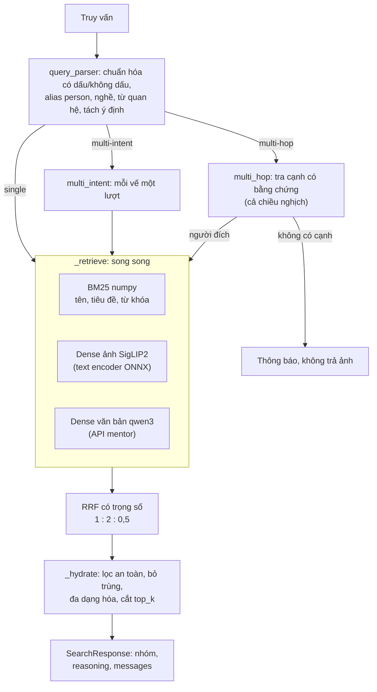

# Tài liệu kỹ thuật: truy xuất ảnh người nổi tiếng Việt Nam (Phần B)

Tài liệu này mô tả hệ thống truy xuất ảnh bằng ngôn ngữ tự nhiên (Phần B của capstone): kiến trúc, các quyết định thiết kế kèm số đo, kết quả đánh giá, hiệu năng, triển khai và hạn chế. Phần A (kiểm duyệt ảnh) là future work, không làm trong capstone; hạn chế của Phần B do thiếu Phần A và cách nối ở [part_a/](../part_a/README.md).

- Kế hoạch và phương án ban đầu: [capstone/PLAN.md](../capstone/PLAN.md). Kịch bản người dùng có mã (E2, M1, H3…): [capstone/SCENARIOS.md](../capstone/SCENARIOS.md).
- Cách chạy lại từ đầu: [part_b/README.md](../part_b/README.md).
- Báo cáo: [reports/eval.md](../reports/eval.md) (dev + test), [reports/perf.md](../reports/perf.md) (benchmark). Các báo cáo khác (`eval_dev.md`, `eval_test.md`, `dense_bakeoff.md`, `mentor_bakeoff.md`) sinh lại khi chạy script, không commit.

Mọi số liệu gắn nhãn **[Đã đo]** (đo thật, ghi máy và điều kiện) hoặc **[Ước tính]** (chưa đo, hoặc chấm bằng mắt). Máy đo, trừ khi ghi khác: laptop Intel Core Ultra 7 155H (22 luồng logic, 31,4 GB RAM), Windows 11, không GPU.

## 1. Bài toán và phạm vi

Đầu vào là câu truy vấn tiếng Việt, có dấu hoặc không. Đầu ra là ảnh của người nổi tiếng Việt Nam, chia theo nhóm, kèm lời giải thích. Có ba loại truy vấn:

| Loại | Ví dụ | Hệ thống phải làm |
|---|---|---|
| Single-intent | "Đen Vâu", "Đặng Văn Lâm bắt bóng", "hoa hậu đội vương miện" | Nhận người hoặc chủ đề; xếp ảnh theo phần mô tả |
| Multi-intent | "Trấn Thành và Hari Won", "ảnh A chụp cùng B" | Tách ý định; mỗi ý một nhóm cân bằng; thêm nhóm ảnh chung |
| Multi-hop | "vợ của Trấn Thành", "con trai Phạm Nhật Vượng" | Tìm người gốc, đi theo cạnh quan hệ **có bằng chứng**, trả ảnh người đích. Không có bằng chứng thì nói không có và **không trả ảnh** |

Yêu cầu không chức năng:
- ≥ 80.000 ảnh;
- latency < 3 s;
- chạy bằng Docker, index lưu trên object storage (S3/MinIO);
- không có chức năng tìm bằng ảnh khuôn mặt (SCENARIOS X1).

## 2. Dữ liệu

### 2.1 Nguồn và hợp nhất [Đã đo]

Dữ liệu gốc là 3 file CSV ảnh đã duyệt (`people-handpick-recrawl-merged-part*.csv`) của team. Dữ liệu này không có trong repo vì là ảnh người thật.

| | Số lượng |
|---|---|
| Dòng CSV | 92.140, tất cả `approved`; 8.045 entity |
| Dòng thiếu sha256 | 7.979: lấy sha từ ảnh cùng URL (437) hoặc tải lại ảnh (6.329); 1.213 dòng không cứu được thì bỏ |
| **Ảnh trong index** | **90.056** (mỗi sha256 một bản ghi; ảnh trùng giữa các entity chỉ hiện một lần, E7) |
| Entity → person | 8.029 → **5.653** person |
| Ảnh có tiêu đề bài báo | 79.184 (10.872 ảnh không có) |
| Caption VLM | **không có** trong CSV |
| Ảnh có vector SigLIP2 | 89.305 (99,2%); số còn lại không tải được |

Pipeline offline: `fetch_missing_images.py` → `merge_data.py` (39 s) → `encode_images.py` (~1,7 h, CPU) → `build_index.py` (29 s) → `encode_texts.py` (23 phút, qua API mentor). Đầu ra là `index/v{ver}/`:
- `meta.sqlite`: metadata và đồ thị tri thức;
- `lexical.npz`: BM25;
- `dense.npz`: vector ảnh;
- `text_dense.npz`: vector văn bản;
- `manifest.json`.

Schema (bảng `person`, `entity`, `image`, `image_entity`, `image_person`, `relation`): [part_b/src/imgsearch/data/schema.sql](../part_b/src/imgsearch/data/schema.sql).

### 2.2 Gộp entity thành person

Một người thường có nhiều entity ("Đen Vâu", "Đen (rapper)", "Nguyễn Đức Cường (Đen Vâu)"). `data/entity_merge.py` gộp chỉ dựa trên tên:
- bỏ cụm mô tả và học hàm ở đầu tên;
- cụm theo tên **giữ dấu** và nhóm nghề;
- tên 2 âm tiết gộp vào tên dài duy nhất cùng nhóm nghề;
- biệt danh trong ngoặc chỉ được nhận khi một trong hai tên dài ≥ 3 từ.

Lần chạy đầu trên dữ liệu thật tạo một "person" gồm **128 entity**: các tên chương trình/ban nhạc trong ngoặc như "(The Voice)" nối chuỗi nhiều người khác nhau. Sau khi sửa, cụm lớn nhất còn 25 entity (H'Hen Niê, đúng). Gộp bằng tên không sửa được lỗi gán nhãn; việc đó cần đặc trưng khuôn mặt từ Phần A.

### 2.3 Đồ thị tri thức cho multi-hop

Cạnh quan hệ lấy từ **tiêu đề bài báo** (`kg/article_relations.py`). Luật được viết để ưu tiên độ chính xác:
- tên phải khớp đúng (không khớp mờ), viết hoa, ≥ 2 từ, không bị cụt ở hai đầu;
- chỉ nhận dạng đồng vị ("X - con gái nhạc sĩ Y") hoặc từ tự xưng ("ông xã", "cưới");
- mỗi cạnh lưu `source` và `evidence` (tiêu đề + URL).

Lần chạy đầu có 273 cạnh, phần lớn sai. Sau 4 vòng sửa còn 37 dòng bằng chứng (28 cạnh: 20 vợ/chồng, 11 cha mẹ/con, 6 anh chị em).

Kiểm tay 27 cạnh dùng trong test set [Đã đo, một người kiểm]:
- 24 cạnh đúng;
- 1 cạnh sai: Đức Phúc – Diệu Nhi, từ tiêu đề "Đức Phúc, chồng Diệu Nhi nói gì…";
- 3 cạnh vợ/chồng chỉ đúng trong quá khứ vì đã ly hôn.

Wikidata chưa làm.

## 3. Kiến trúc

Hướng chọn là H2 trong PLAN 4.2: phân tích truy vấn bằng quy tắc, liên kết person, truy xuất lai (từ khóa + vector), rồi đi trên đồ thị tri thức. Hướng tác tử LLM (H3) bị loại vì chậm và dễ bịa quan hệ.

| Thành phần | File | Ghi chú |
|---|---|---|
| Chuẩn hóa tiếng Việt | `text/normalize.py` | `normalize` (giữ dấu) và `fold` (bỏ dấu, `đ` → `d`); ưu tiên khớp có dấu |
| Phân tích truy vấn | `retrieval/query_parser.py`, `aliases.py`, `lexicon.py` | Quy tắc + từ điển alias (khớp dài nhất, khớp mờ rapidfuzz cho tên sai chính tả). Toàn bộ từ vựng nằm trong `lexicon.py` |
| Từ khóa | `retrieval/bm25.py`, `lexical.py` | BM25 tính sẵn dạng CSR; mỗi từ sinh term có dấu và không dấu; trường tên ×3 |
| Dense ảnh | `retrieval/dense.py` | Ma trận float32 trong RAM, cosine trên toàn ma trận bằng numpy |
| Dense văn bản | `retrieval/mentor.py` | qwen3-embedding-4b qua API, cắt còn 1.024 chiều lúc nạp, timeout 1 s, lỗi thì bỏ kênh |
| Gộp | `retrieval/fusion.py` | RRF `Σ w/(60 + hạng)` |
| Điều phối | `retrieval/engine.py` | Mỗi bước ghi thời gian vào header `Server-Timing` |
| API | `api/main.py`, `api/metrics.py` | FastAPI `/search`, `/healthz`, `/metrics`; semaphore `SEARCH_CONCURRENCY` |
| Web | `web/` | HTML + TypeScript thuần, hiển thị nhóm và chuỗi bằng chứng |

Cách xử lý từng trường hợp:

- **Có person**:
  - Ảnh khớp phần mô tả được xếp trước, sau đó là **mọi ảnh còn lại** của người đó (S1). Người dùng không mất ảnh chỉ vì tiêu đề không nhắc "sân khấu".
  - Hai kênh dense nhận phần mô tả **đã bỏ tên người**, vì model ảnh không nhận ra mặt người nổi tiếng. Danh tính đến từ bộ lọc person.
  - Truy vấn chỉ có tên thì không gọi dense.
- **Không có person** ("doanh nhân phát biểu"):
  - BM25 + dense, giới hạn theo nghề nếu truy vấn có nghề;
  - đa dạng hóa: mỗi người tối đa 3 ảnh ở đầu danh sách.
- **Trùng tên** ("Quang Hải"): mỗi người một nhóm, nhãn kèm nghề, kèm gợi ý thêm nghề để chọn đúng người.
- **Tên lạ**: chỉ thông báo, không trả ảnh của người có tên gần giống (E6).
- **Multi-intent**: mỗi vế một nhóm. Thêm nhóm "Cùng xuất hiện" khi ≥ 2 người khác nhau có ảnh chung.
- **Multi-hop**: hiển thị chuỗi `người gốc →(quan hệ, bằng chứng)→ người đích`. Người gốc trùng tên thì hỏi lại, không chọn bừa.
- **Dữ liệu cố định theo phiên** (ảnh theo nghề, ảnh bị lọc an toàn) được tính sẵn lúc nạp. Đường `/search` không chạy SQL nặng.

## 4. Quyết định thiết kế và số đo

| Quyết định | Phương án bị loại | Số đo dẫn tới quyết định |
|---|---|---|
| **BM25 tự viết bằng numpy** | SQLite FTS5 (phương án trong PLAN) | FTS5 mất 100–150 ms/truy vấn trên 80k ảnh, phần lớn là tính `bm25()` cho ~70k tài liệu khớp. BM25 numpy mất 4–6 ms (p95 ≤ 7,1 ms) [Đã đo] |
| **Không dùng FAISS**: nhân ma trận numpy trên toàn bộ 90k vector | FAISS flat, Qdrant | 90k × 768 chỉ là một phép nhân ma trận; vector store riêng không đáng thêm phụ thuộc. Đã bỏ `faiss-cpu` khỏi phụ thuộc |
| **Model ảnh `siglip2-b32`** (open_clip ViT-B-32-SigLIP2-256) | siglip2-b16, xlmr-b32, siglip-i18n-b16 | Bake-off 496 ảnh golden, 11 truy vấn bối cảnh. nDCG@10 của BM25 + ảnh: b16 0,68, **b32 0,64**, xlmr 0,65. Tốc độ mã hóa ảnh 14,7 ảnh/s (b32) so với 4,2 ảnh/s (b16): toàn bộ 90k mất 1,7 h so với 5,9 h trên CPU [Đã đo]. Chênh chất lượng nằm trong nhiễu của bộ nhỏ |
| **Text encoder ONNX fp32** ở runtime, không torch | int8 động; torch trong API | int8 lệch quá xa fp32: cosine chỉ 0,83–0,94. ONNX fp32 khớp torch (cosine 1,0000), p50 30 ms/truy vấn khi máy rảnh, ~65 ms trong container 4 CPU [Đã đo]. Image API không có torch |
| **Ngưỡng dense là "cổng"**: ảnh khớp nhất có xác suất SigLIP < 0,1 thì bỏ cả kênh | Cắt từng ảnh dưới ngưỡng | Cắt từng ảnh làm golden tụt mạnh (q18 0,53 → 0,06), vì danh sách dense quá ngắn và RRF chỉ còn BM25. Với cổng, "xyz abc" (p = 0,008) không trả 200 ảnh ngẫu nhiên [Đã đo] |
| **Trọng số RRF ảnh = 2** | 1, 3, 8 | Dev, 18 truy vấn bối cảnh: w2 cho nDCG@10 0,84, w8 cho 0,83, chỉ BM25 cho 0,69 [Đã đo] |
| **Kênh văn bản qwen3 bật, trọng số 0,5** | tắt; trọng số 1–2 | Dev: nDCG@10 0,84 → 0,85, R@50 0,76 → 0,80 [Đã đo]. Trọng số 1–2 làm giảm trên dữ liệu thật dù tốt nhất trên golden. Cái giá: p95 engine 45 → ~300 ms, QPS Docker 31 → 20–25 |
| **Bỏ reranker** jina-reranker-v2 | rerank top-50 | Không có caption thì reranker chỉ đọc được tiêu đề, nên kéo ảnh đúng về hình xuống. Golden không caption: nDCG@10 0,64 → 0,44 [Đã đo] |
| **`SEARCH_CONCURRENCY=2`** (semaphore) | không giới hạn | Không giới hạn: 33,9 QPS ở 4 VU nhưng **sụp còn 16,6** ở 16 VU, do ORT/BLAS của nhiều request tranh 4 CPU. Với c2: 31,2 QPS, giữ 29,9 ở 16 VU [Đã đo, không kênh văn bản]. Lời gọi mạng tới mentor được gửi trước khi vào hàng đợi (`engine.prefetch`) |
| **`OPENBLAS_NUM_THREADS=4`** trong Docker | mặc định | numpy mở 22 luồng theo số lõi của máy, không theo giới hạn 4 CPU. p95 tuần tự 193 → 153 ms [Đã đo] |
| **MinIO Chainguard** ghim digest | `minio/minio` chính thức | Ngày 20/10/2026 image chính thức không còn kéo công khai được ("pull access denied") |
| **LLM chỉ là parser fallback** | tác tử LLM | Quy tắc chạy vài ms và xác định được. LLM không được trả lời quan hệ (cạnh phải có bằng chứng). Fallback LLM **chưa cài** (mục 8) |

Golden và dữ liệu thật đôi khi cho kết luận ngược nhau. Ví dụ, trọng số kênh văn bản tốt nhất là 2 trên golden nhưng là 0,5 trên dev thật. Golden có tiêu đề sạch và ít ảnh. Vì vậy mọi tham số cuối cùng được chọn trên split dev của test set dữ liệu thật.

## 5. Đánh giá

### 5.1 Test set [Đã đo]

`testsets/queries.v1.jsonl` gồm 161 truy vấn (81 single, 33 multi-intent, 47 multi-hop), chia xen kẽ trong từng mã kịch bản thành **dev 82 / test 79**. Có hai nguồn:

- **Sinh tự động** từ `meta.sqlite` (`eval/testgen.py`, không gọi engine để không thiên về câu hệ thống làm đúng): tên phân tầng theo số ảnh, không dấu (L1), trùng tên (E2/E3), tên bịa (E6), multi-intent, multi-hop từ cạnh KG. Đáp án là mọi ảnh của person, kể cả các mảnh person bị tách.
- **Viết tay**: 32 truy vấn bối cảnh, biệt danh (L3), multi-hop phủ định. Truy vấn bối cảnh được chấm tay 0/1/2 trên pool gộp top-20 của các cấu hình: 1.344/1.344 ảnh có nhãn, một người chấm.

Chỉ số (PLAN 5.2):
- P@10, P@10 chỉ tính nhãn 2;
- P@R với R = min(|đúng|, 10);
- R@50 chuẩn hóa theo min(|đúng|, 50);
- nDCG@10, MRR;
- hành vi đúng (trả kết quả, hỏi lại, từ chối);
- riêng multi-hop: tỷ lệ bịa.

Mọi tham số được tinh chỉnh trên dev. **Split test chỉ chạy một lần** (20/10/2026), sau khi đã chốt cấu hình.

### 5.2 Kết quả [Đã đo]

| Split | Truy vấn | Hành vi đúng | P@10 | P@10 nhãn 2 | R@50 | nDCG@10 | MRR |
|---|---|---|---|---|---|---|---|
| dev | 82 | 80/82 | 0,89 | 0,75 | 0,93 | 0,94 | 0,97 |
| **test** | **79** | **77/79** | **0,87** | **0,75** | **0,89** | **0,92** | **0,96** |

Theo loại truy vấn (test):
- single 40/41, nDCG@10 0,87;
- multi-intent 15/15, nDCG@10 0,95, phủ ý định@10 1,00;
- multi-hop 22/23, người gốc đúng 23/23, người đích đúng 17/17, bịa 1/23.

Ablation trên truy vấn bối cảnh (chấm tay, 18 truy vấn mỗi split):

| Cấu hình | dev nDCG@10 | test nDCG@10 | test P@10 nhãn 2 | test R@50 |
|---|---|---|---|---|
| chỉ BM25 | 0,69 | 0,70 | 0,59 | 0,58 |
| BM25 + ảnh (w2) | 0,84 | 0,80 | 0,75 | 0,68 |
| BM25 + ảnh (w8) | 0,83 | 0,78 | 0,72 | 0,60 |
| **BM25 + ảnh + văn bản (mặc định)** | **0,85** | **0,81** | **0,76** | **0,72** |

Nhận xét:
- Dense ảnh đóng góp nhiều nhất (+0,10 nDCG@10 trên test), vì dữ liệu không có caption.
- Kênh văn bản chỉ thêm ít (+0,01 nDCG@10, +0,04 R@50).
- Thứ tự các cấu hình giữ nguyên từ dev sang test.

Lỗi còn lại trên test:
- "vợ của Đức Phúc" bị bịa, từ cạnh sai đã biết.
- "Đinh Thị Hoa Mơ" (tên không có trong dữ liệu) khớp nhầm Nguyễn Đình Thi, vì khi bỏ dấu "Đinh Thị" và "Đình Thi" là một.
- "Hà Hồ" bị liên kết sang một person khác bị tách mảnh.
- Trùng tên kèm mô tả ("Quang Hải ăn mừng bàn thắng") vẫn chia nhóm mà chưa dùng phần mô tả để chọn người.

Danh sách đầy đủ ở `reports/eval.md`.

## 6. Hiệu năng [Đã đo]

Điều kiện đo:
- `docker compose`: container api giới hạn 4 CPU / 4 GB, uvicorn 1 worker, ONNX 4 luồng;
- k6 chạy cùng máy;
- 100 truy vấn lấy từ test set (50% single, 30% multi-intent, 20% multi-hop);
- 1/4/8/16 VU, mỗi mức 60 s;
- `nocache` tắt cache vector truy vấn, đây là số chính.

Chi tiết ở `reports/perf.md`.

| Cấu hình | QPS đỉnh (p95 < 3 s) | p95 ở 1 VU | p95 ở 16 VU | RAM api |
|---|---|---|---|---|
| BM25 + ảnh, nocache | 31,2 | 159 ms | 926 ms | 1,83 GB |
| BM25 + ảnh + văn bản (mặc định), nocache | 20–25 (dao động theo máy mentor) | 332 ms | 1,2–1,6 s | 2,2 GB |
| BM25 + ảnh, có cache vector truy vấn | 165 | | 153 ms | |

- 0% lỗi HTTP ở mọi lần đo. Từ lúc khởi động tới `/healthz` 200 mất 9–14 s (tải index từ MinIO + nạp model).
- Engine một luồng, không HTTP:
  - p95 45 ms khi không có kênh văn bản;
  - 278–300 ms khi có kênh văn bản (trên dev);
  - 704 ms trên lần chạy test: latency của API mentor dao động.
- Yêu cầu p95 < 3 s đạt ở mọi mức tải đã đo.
- Kênh văn bản dùng key mentor bị giới hạn **100 request/phút**. Khi tải vượt khoảng 1,7 truy vấn có mô tả mỗi giây, API trả HTTP 429. Engine khi đó bỏ kênh văn bản: HTTP vẫn 200 nhưng chất lượng về mức BM25 + ảnh.

## 7. Triển khai

- **Docker Compose** gồm 3 service:
  - `minio`: object storage;
  - `init`: dùng chính image API, tạo bucket private và đẩy thumbnail rồi mới đẩy `index/v{ver}/`, bỏ qua file đã có. `thumbs.txt` chỉ liệt kê id đã có thumbnail trên bucket, nên đẩy dở dang không tạo ô ảnh hỏng;
  - `api`: tải index từ MinIO về volume cache lúc khởi động, rồi nạp.
- **Thumbnail** (PLAN 7.4): WebP 320 px cho 89.305 ảnh có file nguồn, 0,719 GB, 7,9 KB/ảnh [Đã đo]. Lưu ở `thumbs/{id[:2]}/{id}.webp` trên bucket private; trình duyệt tải bằng presigned URL hạn 6 giờ (`PRESIGN_TTL_SECONDS`; cùng URL trong nửa hạn để trình duyệt cache được), ký với địa chỉ trình duyệt tới được (`S3_PUBLIC_ENDPOINT_URL`). Ảnh không có thumbnail (~0,8%) vẫn hotlink. Ô xem ảnh lớn dùng ảnh gốc (`image_url`), lỗi thì quay về thumbnail. Đo trên 196 ảnh đầu của 12 truy vấn demo: 194 hiển thị được, 2 hỏng là hotlink tới link đã chết [Đã đo, compose local]; trước đó hotlink toàn bộ hỏng 38/196.
- **Bản public** (`docker-compose.public.yml`): máy chủ không cần `data/` hay `models/`. API tải index, model ONNX và danh sách thumbnail từ **Cloudflare R2** (bucket private, ~2,6 GB, dưới mức miễn phí 10 GB) lúc khởi động; thumbnail đi thẳng từ R2 tới trình duyệt. Lần chạy đầu (volume cache trống) tải khoảng 1,5–2 GB trước khi API nhận request [Ước tính], nên healthcheck của bản public có `start_period` 30 phút. Mở ra Internet bằng Cloudflare quick tunnel từ chính máy đã benchmark. Không dùng HF Spaces: Docker Space cần gói trả phí (kiểm 21/10/2026).
- **An toàn khi public** (X2, X4):
  - mật khẩu dùng chung (`DEMO_PASSWORD`, HTTP Basic, mọi đường dẫn trừ `/healthz`; thiếu thì compose public không chạy);
  - giới hạn 30 truy vấn/phút mỗi IP; gửi sai mật khẩu quá 10 lần/phút (`AUTH_FAIL_PER_MINUTE`) thì IP đó nhận 429 trong một phút, kể cả khi thử đúng, để không dò được mật khẩu;
  - client không tắt được lọc an toàn (`ALLOW_UNSAFE_SEARCH=false`);
  - truy vấn tìm ảnh nhạy cảm của người thật bị từ chối và ghi log (`retrieval/guard.py`): từ khóa rõ ràng luôn chặn; bikini, nội y, gợi cảm, thi thể chỉ chặn khi có tên người; gỡ các kiểu lách "k.h.ỏ.a t.h.â.n", "s e x", "nud3". Dev eval không đổi sau khi thêm (80/82, nDCG@10 0,94) [Đã đo];
  - nhãn nhóm ghi mô tả là tiêu chí xếp hạng ("Phạm Nhật Vượng · xếp theo “bị bắt”") kèm dòng "không xác nhận sự kiện", để không lặp lại tiền đề sai.
- `/healthz` trả 503 cho tới khi nạp xong. Có `REQUIRE_INDEX=true` thì thiếu index là 503 mãi, không chạy với index rỗng.
- `/metrics` (JSON, tính từ lúc khởi động):
  - số request theo loại truy vấn, truy vấn rỗng, có thông báo, lỗi;
  - histogram latency và p50/p95/p99 trên 1.000 request gần nhất;
  - thời gian trung bình từng bước của `Server-Timing`;
  - số lời gọi, lỗi và lần bị giới hạn (429) của API mentor.
- **CI** (GitHub Actions, `.github/workflows/ci.yml`): mỗi lần push `main` hoặc mở pull request thì chạy ruff, pytest (dữ liệu giả, không cần `data/`), rồi build image Docker.
- Index có phiên bản `index/v{INDEX_VERSION}/` trên S3/MinIO/R2 (đổi bằng `S3_ENDPOINT_URL`). Model ONNX được mount chỉ đọc (compose local) hoặc tải từ `models/` trên S3 (`MODELS_FROM_S3`, bản public).
- Image API: Python 3.12 slim, không torch, chạy bằng user thường. Web được build ở stage Node riêng.
- Quyền riêng tư:
  - bucket để private;
  - không commit ảnh, CSV, embedding, index hay model;
  - kênh văn bản chỉ gửi **văn bản** (tiêu đề, tên) cho API mentor, không gửi ảnh.

## 8. Hạn chế

**Dữ liệu**
- Bảng person lẫn tổ chức và nhãn nhóm ("REE Corporation", "HCV SEA Games"), cùng nhãn ghép hai người.
- Một số alias là rác ("Silicon Valley" là alias của một người).
- Có person bị tách đôi chưa gộp: `B Ray`/`BRay`, "Hà Hồ"/Hồ Ngọc Hà. Gộp bằng tên không sửa được; cần khuôn mặt (Phần A).
- Không có caption VLM: truy vấn mô tả cảnh dựa vào tiêu đề bài báo (nhiễu, ảnh minh họa) và dense ảnh.
- Model ảnh không hiểu một số khái niệm Việt, ví dụ "áo dài": ảnh đúng nằm ở hạng 41–234.
- Ảnh gần trùng (khác sha256) vẫn hiện hai lần, chờ `dup_of` của Phần A (Q3). Chưa dùng đặc trưng khuôn mặt để xếp hạng.

**Đồ thị tri thức**
- Chỉ có 28 cạnh từ tiêu đề bài báo, vì luật ưu tiên độ chính xác; Wikidata chưa làm.
- Không có thời gian (vợ/chồng đã ly hôn vẫn được trả, kèm bằng chứng). Không phân biệt con nuôi.
- Còn một cạnh sai đã biết (Đức Phúc – Diệu Nhi), gây 1 truy vấn bịa trên mỗi split.
- Chưa có multi-hop 2 bước (H5).

**Đánh giá**
- Golden (500 ảnh) là tập phát triển, không tách dev/test, nên số đo trên golden lạc quan.
- Chỉ có 32 truy vấn bối cảnh chấm tay, một người chấm. Không đo được độ đồng thuận giữa người chấm. Chênh lệch giữa các cấu hình nhỏ hơn 0,02 thì nằm trong nhiễu.
- Đáp án "rule" (mọi ảnh của person) mặc định là nhãn person đúng; lỗi gán nhãn trong dữ liệu không được phát hiện.

**Vận hành**
- Kênh văn bản phụ thuộc tunnel tạm của mentor (URL có thể đổi) và giới hạn 100 request/phút. Khi lỗi, hệ thống tự quay về BM25 + ảnh.
- Text encoder fp32 chiếm 1,1 GB RAM; tổng RAM API ~2,2 GB.
- Benchmark chạy trên laptop, k6 cùng máy, chỉ 100 truy vấn lặp lại (chế độ cache vì vậy lạc quan).
- Ảnh không có thumbnail (~0,8%) vẫn hotlink `image_url` gốc. Hotlink không ổn định: đo 20/10/2026, hotlink toàn bộ thì 38/196 ảnh hỏng (30 từ một CDN ngắt kết nối khi tải dồn). Web thử lại ảnh lỗi một lần, vẫn lỗi thì hiện ô "Không tải được ảnh gốc" kèm link bài nguồn.
- Bản public chạy trên laptop qua quick tunnel: URL đổi mỗi lần chạy, chỉ sống khi máy bật; mật khẩu dùng chung, không phải đăng nhập theo người.
- Chặn truy vấn nhạy cảm chỉ ở mức từ khóa (luôn lách được bằng cách diễn đạt khác); lọc ảnh nhạy cảm thật sự cần điểm của Phần A. Hiện lọc an toàn theo ảnh chặn 0 ảnh vì dữ liệu chưa có điểm `nsfw_score` / `sensitive_flag` nào.

**Chưa làm**
- LLM parser fallback: chỉ có cờ `LLM_PARSER_ENABLED`, chưa cài.
- Dense văn bản chạy local, không phụ thuộc mentor (multilingual-e5).
- Deploy lên máy chủ riêng có tên miền cố định (hiện là tunnel từ laptop; CI đã có).
- Phủ định và đếm số lượng: hệ thống chỉ thông báo hạn chế, chưa xử lý.

## 9. Hướng mở rộng

- **Quy mô 10–100M ảnh**: thay nhân ma trận toàn bộ bằng ANN (IVF-PQ hoặc HNSW) và BM25 bằng engine có shard. Index vẫn có phiên bản trên object storage. Lọc theo person dùng danh sách hàng tính sẵn như hiện nay.
- **Chất lượng**:
  - thêm caption VLM, sau đó hạ trọng số ảnh, vì khi có caption BM25 đã mạnh;
  - quan hệ từ Wikidata;
  - gộp person bằng tâm khuôn mặt của Phần A;
  - dùng phần mô tả để chọn người khi trùng tên ("Quang Hải ăn mừng bàn thắng" → cầu thủ).
